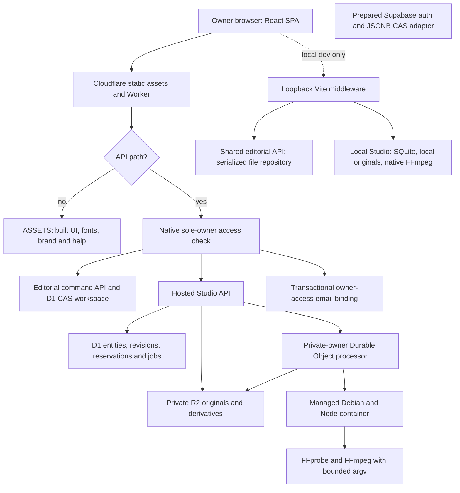

# 01 — Architecture and stack

## Runtime composition

marKER is a React/TypeScript/Vite single-page console with one shared editorial domain, a separate media Studio domain, environment-specific persistence and an optional decorative canvas. There is no implemented multi-tenant service or connected social scheduler. The selected hosted default is the native Worker route; the alternative Supabase adapter is exported preparation and is not selected by that default.

Source anchors: `package.json:L1-L26`, `server/entry.ts:L1-L2`, `server/worker.ts:L106-L128`, `vite.config.ts:L28-L142`, `src/core/settings.ts:L1-L39`. Exact locked versions are in [the dependency reference](10-source-map-tests-and-dependencies.md).

## Functional nodes

| Node | Responsibility | State/effect and failure boundary |
| --- | --- | --- |
| React application shell | Session bootstrap, language, Environment, sign-in/out, decoration lifecycle. | Browser UI/preferences; server decides access. Network failure cannot manufacture an authenticated session. |
| Editorial console | Products, account metadata, earlier text sources/campaigns, per-destination drafts and outcomes. | Sends a command with expected workspace revision; handles rejection/409 without overwriting newer state. |
| Studio UI | Material capture, upload/resume, campaign variants, planner, preview, approval and export. | Separately versioned Studio state and persisted jobs; browser recovery is not a durable job ledger. |
| Pure editorial domain | Relationships, validation, transitions, slot conflicts and dependency-aware deletion. | Deterministic state transition; no provider network effect. |
| Pure Studio/planner domain | Rights, recipes, fingerprint/provenance, ranges, approval and export rules. | Rejects invalid/stale proposals and recipe edits invalidate review. Rules do not infer semantic quality. |
| Native access layer | Email challenge, browser proof, durable rate limiting, opaque session, expiry and Origin checks. | Dedicated D1 records and mail; sole-owner admission, no public registration. |
| D1 editorial repository | Stores one bounded JSON workspace and revision; guards cross-domain product references. | Atomic compare-and-swap; 1 MiB editorial ceiling. |
| Studio hosted service | Validates normalized metadata, upload/job admission, R2 streams, settings and usage. | D1/R2/job stages are distinct; partial failures require reconciliation, not whole-state overwrite. |
| Durable Object | Serializes private-owner native operations and saved render dispatch/recovery. | Native container lifecycle, wall deadline and destruction; not a general remote execution API. |
| Native runner | Controlled probe/render/analysis over staged local files. | Bounded input/output metadata, fixed process arguments, no browser executable/filter/path input. |
| R2 | Original bytes and derived files. | Private binding; authenticated Worker reads/ranges, no public bucket credentials. |
| Local adapters | Engineering storage and native tools. | Loopback/Origin boundary; one process per data path; does not emulate hosted email login. |
| Prepared Supabase | Alternative auth and owner-restricted JSONB RPC contract. | Inactive alternative; no activation inferred from file presence. |
| Decoration | Original character atlas, scenes/scheduler/renderer, including Cueca. | UI-only playback/cache lifecycle; independent of product persistence and processing. |

## Dependencies and packaging

Application npm dependencies are React and React DOM. TypeScript, Vite, Wrangler and type packages are development/build dependencies. The processor uses platform APIs and native Debian packages rather than an added npm execution framework. See [locked dependency inventory](10-source-map-tests-and-dependencies.md); the top-level package declares version `0.1.0`, which is not a unique release identifier. The source commit is the snapshot identity.

`npm run build` first stages three exact tracked TypeScript sources as ignored text resources, then checks frontend/server types, builds static assets and verifies immutable brand integrity. This publication does not execute that build. The generator prepares the renderer and both analysis layers; describing it as only one renderer copy would miss current packaging. Source: `tools/prepare-processor.mjs:L1-L8`.

Worker ingress runs `/api/*` through the Worker before assets and uses SPA fallback for other browser navigation. The entry re-exports the Worker and `StudioProcessor`. Binding roles are `ASSETS`, `DB`, `EMAIL`, `MEDIA` and `STUDIO_PROCESSOR`, plus origin/owner/sender configuration and a secret supplied outside tracked code. Instance identifiers and address values are deliberately omitted. The configured daily scheduled event only purges expired auth state; it is not social posting, render polling or AI generation.

The local Vite plugin applies during serving, restricts host and socket to loopback, rejects cross-site/incorrect Origin requests, serializes API requests and denies private/runtime paths to the file server. Its local session endpoint reports local authenticated mode. Local editorial JSON and Studio SQLite/files do not replicate hosted D1/R2/auth semantics.

## Cross-domain and external-effect boundaries

Editorial commands cannot delete a product referenced by Studio material/campaigns. Both commit orders must preserve that invariant: a prior frontend check alone would race. Settings has its own revision while processing admission reads saved caps in the backend. Detailed transactions are in [chapter 02](02-data-model-and-transactions.md).

Render request admission, durable job creation, enqueue, native execution, object storage finalization and user approval/export are different nodes. A timeout at one node cannot prove that earlier nodes did not commit. [The media trace](code-flow/03-media-planning-render-export.md) follows those transitions.

The container currently starts a managed Debian image, enables internet for package bootstrap and installs FFmpeg/fonts during operations. Its wall deadline includes bootstrap/transfers. Dependency resolution and cold-start reliability therefore remain operational concerns; a constant hosted analysis tool version is deliberately not asserted. The source's bounded diagnostics classify failures without logging raw media/text/arguments. Source: `server/studio-processor.ts:L117-L228`.

## Documentation reconciliation

The final paragraph of the older `docs/architecture.md` still calls private R2/media/jobs future work. Current Studio sources, configuration, migrations and `docs/hosted-studio.md` describe their implementation. This dossier follows the pinned implementation and records that stale prose rather than proposing duplicate Studio infrastructure. Older local-only passages in setup/backlog documents are historical boundaries, not proof that current hosted adapters are absent.

No live configuration, deployed migration/catalog inventory, authenticated media operation or provider account was accessed for this dossier. Configuration is source evidence; availability and exact deployed behavior require their own readback.
