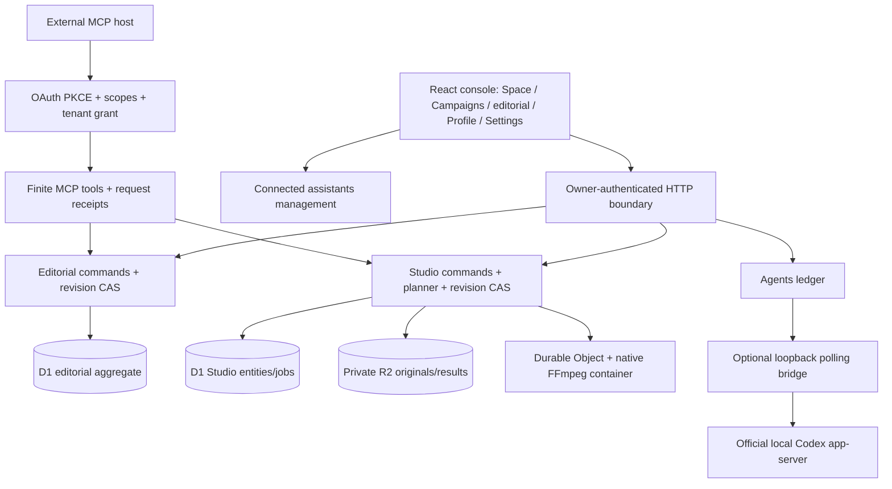

# 01 — Architecture and stack

The product is a React/TypeScript SPA with a shared Fetch-style backend and two runtime adapters. Vite serves loopback engineering APIs with local files/SQLite; the hosted Worker uses native authentication, D1, private R2 and a Durable Object managed-container processor. Supabase/PostgreSQL is retained as an inactive prepared editorial adapter.

| Boundary | Main source | Responsibility |
| --- | --- | --- |
| Browser | [Console](source/src/console/Console.tsx), [Studio](source/src/console/Studio.tsx) | Forms, drafts, selection, feedback, explicit human actions. |
| Domain | [domain](source/src/core/domain.ts), [studio](source/src/core/studio.ts) | Valid states, source/rights relationships, revision/approval rules. |
| Native preparation | [classifier](source/src/core/studio-classification.ts), [planner](source/src/core/studio-planner.ts), [analysis contract](source/src/core/studio-analysis.ts) | Rules, literal content, bounded proposals and optional technical aids. |
| Hosted entry | [entry](source/server/entry.ts), [worker](source/server/worker.ts) | Static/demo routing, native auth, lifecycle, API dispatch. |
| Storage | [D1](source/server/d1.ts), [hosted Studio](source/server/studio-hosted.ts), [local Studio](source/server/studio-local.ts) | Independent editorial/Studio revisions, objects, jobs and admission. |
| Native media | [renderer](source/server/studio-render.ts), [processor](source/server/studio-processor.ts), [runner](source/processor/runner.mjs) | Bounded fixed-argument processes and streamed originals/results. |
| Optional Agents | [API](source/server/agents.ts), [store](source/server/agents-store.ts), [bridge](source/tools/agent-bridge.mjs) | Provider run/proposal/effect custody; local managed-ChatGPT route. |
| External assistant | [MCP transport](source/server/mcp.ts), [authorization](source/server/mcp-auth.ts), [tools](source/server/mcp-tools.ts) | Delegated scoped access through existing product operations. |

The pinned runtime packages include React 19, the official MCP SDK and a Workers-compatible non-code-generating JSON-schema provider. Vite, TypeScript and Wrangler are development/build dependencies. Exact resolved versions, transitive packages and commands are in [dependencies](inventories/dependencies.md). Installing a dependency does not create a provider, migration or deployment.

The architecture is deliberately one operator/one retained tenant. It has no public signup, teams, tenant switching, billing customer model or SaaS allocation. Local development trusts the loopback OS account; it is a different security environment from hosted authentication. Native subprocess controls and agents sharing one host do not prove OS isolation.
