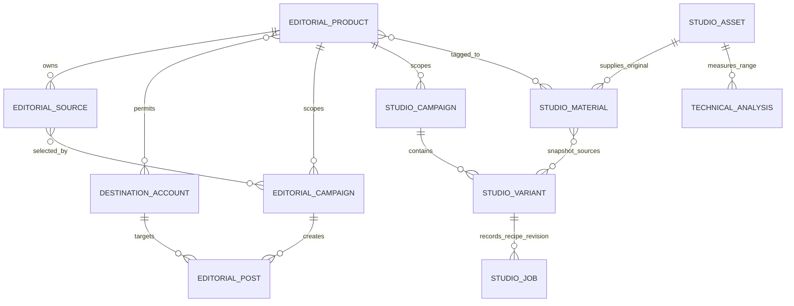
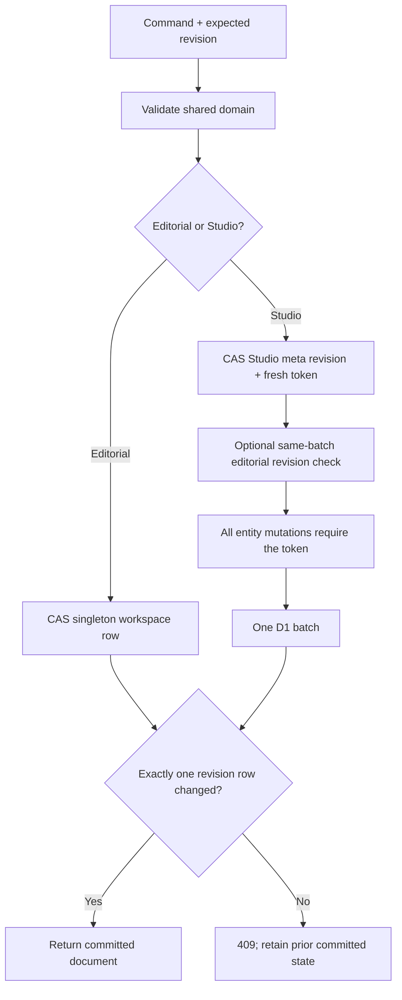

# 02 — Data model and transactions

This describes product source at `1f9415ee19e1e6ed175df6ef8aac8edc7182c9e9`. Source references are locators into the private product repository, not links granting access. The [database reference](database/README.md) supplies structural inventories and an empty reconstruction. No application records, auth material, uploaded media or operational database are included.

## Two content models share products

The original editorial model and the newer Studio model coexist. They are not interchangeable campaigns or a single delivery pipeline. Editorial `Workspace` contains products, destination accounts, text sources, editorial campaigns and posts. Studio stores immutable media assets, editable material cards, account-free campaigns and recipe variants. Studio campaigns reference editorial product IDs, but Studio does not require a destination account or create an editorial post when exporting. Sources: `src/core/domain.ts:L9-L68`, `src/core/studio.ts:L6-L74`.

These are logical relationships. Product-to-Studio links and the arrays embedded in JSON are enforced by application validation and transaction guards; they are not all physical foreign keys.

| Entity | Fields and behavior |
|---|---|
| Product | ID, name, description, audience, language, tone, CTA, HTTP(S) URL, `preparation/available/paused`. Shared root for both models. |
| Destination account | Name, one of Instagram/Facebook/TikTok/LinkedIn/X, URL, one or more product IDs, valid IANA time zone, language. It is a descriptive destination record, not an OAuth credential. |
| Editorial source | Product, title, literal text, optional validated calendar date, creation timestamp. Referenced sources cannot be edited or deleted while a campaign uses them. |
| Editorial campaign | Product, title/objective/audience, selected source IDs, `organic/paid`, currency/budget strings and `draft/paused`. Creation also creates one blank post per selected account. Paid remains paused. |
| Editorial post | Campaign/account IDs, literal text, scheduled ISO instant, `draft/ready/scheduled/published`, format confirmation, external evidence URL. Scheduled/published are human-confirmed records, not automated publication. |

Sources and field bounds: `src/core/domain.ts:L1-L68`, `src/core/domain.ts:L93-L160`, `src/core/domain.ts:L175-L455`.

## Editorial writes and dependency invariants

`applyCommand` clones the prior workspace, validates one named command, increments the workspace revision and rejects a resulting document above 4 MiB. Each collection has an initial 1,000-record ceiling. A missing record produces 404; invalid data normally produces 400; a dependency or immutable-output conflict normally produces 409. URLs accept HTTP(S) without embedded credentials. Account-product membership, time zones, source dates and same-account scheduling collisions are validated server-side. Sources: `src/core/domain.ts:L70-L160`, `src/core/domain.ts:L164-L455`.

| Command family | Referential or state constraints |
|---|---|
| `product.save/delete` | Name required; deletion refuses linked editorial accounts/sources/campaigns. Hosted/local adapters additionally refuse orphaning Studio references. |
| `account.save/delete` | At least one existing product; an account with posts cannot switch platform or detach a product needed by those posts. Posts prevent account deletion. |
| `source.save/delete` | Existing product; title and literal source text required. Campaign use makes the source immutable until dependencies are removed. |
| `campaign.create/delete` | New campaign cannot supply an old ID; selected sources must belong to its product and accounts must admit it. Requires at least one source and account. Existing posts prevent deletion. |
| `post.save` | A scheduled/published record is immutable. Readiness requires nonempty text and human format confirmation; Instagram/TikTok text-only posts remain drafts. Same account and exact instant cannot collide across products. |
| `post.confirm` | Current status must be ready; organic campaign; explicit confirmation and evidence URL; target status scheduled or published. No provider call. |
| `post.delete` | Explicit `confirmed:true`; no automatic purge from copy, download, elapsed time or output status. |

Sources: `src/core/domain.ts:L175-L455`; Studio cross-store guards: `server/d1.ts:L14-L22`, `vite.config.ts:L88-L104`.

## Studio entities and their version axes

| Entity | Significant fields | Version/immutability rule |
|---|---|---|
| `StudioAsset` | Name, canonical MIME, byte size, SHA-256, video/image/audio kind, duration/dimensions, audio-track presence, ready/unsupported processing, creation time. | Server-only registration after storage/probe. Original ID cannot be overwritten; no ordinary original-deletion API exists. SHA plus size supports duplicate detection. |
| `StudioMaterial` | Asset reference or text/idea, product IDs, categories/topics/roles, review, literal text/description, human speech field, rights/restrictions, useful range, optional import origin. | Kind/asset/text change increments `contentVersion`. Rights/restrictions changes clear approval on current variants using it. Other classification changes are independently captured by planner facts. |
| `StudioMaterialOrigin` | Snapshot of an explicitly imported legacy source including source/product refs, text/title/date/time. | Server resolves the original source; origin cannot be replaced on the same material. Import copies context; it does not migrate or delete the legacy record. |
| `StudioCampaign` | Product, title/objective/audience, organic/paid kind, draft/paused status, timestamps. | Paid always paused. Product cannot change once variants exist. |
| `StudioVariant` | Campaign/platform/template, literal hook/body/CTA, duration, contain/cover/focus, mute/keep audio, selected material IDs/ranges/narration, source snapshots, optional planner proof. | Recipe revision starts at 1. Meaningful recipe changes increment it and return draft; equal recipe saves preserve approval. Approval binds the exact revision and, for video, the exact completed job. |
| Source snapshot | Material ID/content version/asset/kind, text/title, speech, rights/restrictions, import origin. | Existing selected snapshots are preserved by ordinary save; explicit `refreshSources:true` selects current material versions. Jobs retain their own copied snapshots. |
| Job | Variant ID, recipe revision, kind render/text-approval, state, timestamps, immutable receipt, optional output dimensions/keys/errors. | Job receipt preserves recipe and source snapshot provenance even if the editable recipe later changes. Public summaries remove internal object keys and full receipts. |
| Technical analysis | Original/hash, millisecond range, profile, tool version, state, bounded result/derivatives. | Cache identity is SHA + range + profile + tool version for nonfailed jobs. It never edits human labels, source originals or selections. Hosted admission is disabled at this snapshot. |

Sources: `src/core/studio.ts:L16-L74`, `src/core/studio.ts:L129-L219`, `src/core/studio.ts:L237-L344`; job representation: `server/studio-hosted.ts:L32-L72`; analysis contract: `src/core/studio-analysis.ts:L1-L72`.

There are four separate revisions: editorial workspace revision, Studio library revision, recipe revision and Settings revision. A change to one is not automatically a change to every other one. Media upload registration advances Studio revision; Settings edits advance Settings revision; render jobs preserve the recipe revision at admission. A stale browser is expected to compare/reload or explicitly re-propose rather than overwrite a concurrent edit. Sources: `server/api.ts:L69-L83`, `src/core/studio.ts:L123-L127`, `src/core/studio.ts:L266-L277`, `server/studio-hosted.ts:L203-L217`.

## Physical storage

| Storage node | Stored structure | Boundary |
|---|---|---|
| Hosted D1 `marker_workspace` | One row (`id=1`) with JSON editorial document and revision. 1 MiB text cap at adapter/schema. | This cap is stricter than the shared domain's 4 MiB ceiling. Do not assume a document valid locally is admissible hosted. |
| Hosted D1 Studio entity tables | Separate assets/materials/campaigns/variants rows; JSON documents plus selected indexed/ref columns. Singleton metadata revision/write token. | Original and derivative bytes are outside D1. |
| Hosted D1 runtime tables | Auth limits/challenges/sessions; uploads/jobs; singleton limits; monthly compute; analysis; singleton Settings. | No raw PIN, session token or owner address is required in auth persistence. |
| Private R2 | Original objects; per-job MP4/PNG; optional analysis JPEGs. | Served through authenticated Worker routes; internal keys are omitted from ordinary summaries. |
| Processor durable storage | Pending IDs, bounded recovery counters and alarms. | Queue recovery state; authoritative jobs/admission remain D1. |
| Local editorial file | JSON workspace at the configured engineering data path. | Serial queue and temporary-file rename. Missing file yields an empty workspace. |
| Local Studio | SQLite in a configured data directory; originals/uploads/renders/analysis subdirectories. | Uses WAL, foreign keys and busy timeout. Local adapter defines its own schema; D1 migrations do not configure the local database. |
| Prepared Supabase alternative | Private single-owner table, editorial JSONB, owner predicate/RLS and CAS RPC. | Exported alternative adapter; not selected by default Worker fetch and does not provide the current hosted Studio path. |

Sources: `migrations-d1/0001_private.sql:L2-L26`, `migrations-d1/0002_studio.sql:L5-L49`, `migrations-d1/0003_studio_hosted.sql:L2-L23`, `migrations-d1/0004_studio_analysis.sql:L3-L20`, `migrations-d1/0005_studio_settings.sql:L3-L13`, `server/local.ts:L11-L54`, `server/studio-local.ts:L99-L170`, `migrations/0001_editorial.sql:L3-L51`, `server/worker.ts:L106-L128`.

SQL comments such as “prepared only” retain historical intent and do not independently prove a migration's current environment status. This dossier reconstructed structure without querying production. Schema presence, deployed configuration and successful runtime execution are separate evidence categories.

## Transaction boundaries

| Transaction | Guard and atomic effects | What is outside the transaction |
|---|---|---|
| Hosted editorial save | Insert revision 1 when absent, or update only matching revision; with Studio enabled, SQL also refuses removing any product referenced by Studio campaigns/materials. Exactly one change required. | Browser state and media are not part of this row. |
| Hosted Studio save | State ≤8 MiB including stored/reserved analysis metadata; row ≤1,500 KiB; mutation count ≤900. CAS meta row assigns a fresh token, optionally checks editorial revision, then token-guards deletions/upserts and attached receipt/upload effects in one D1 batch. | Remote object operations and processing. |
| Upload admission | Reserve declared bytes, claim singleton upload token and persist recoverable upload session in one D1 batch before multipart creation. | Lazy R2 multipart creation/part transfer. |
| Upload completion | Probe/hash trusted bytes; register/deduplicate asset; atomically finalize upload and convert reserved to stored accounting via the Studio write token. | R2 completion, probe compute and duplicate cleanup; conservatively count bytes if duplicate deletion fails. |
| Render/analysis admission | Current Studio revision, compute lease, current Settings budgets/storage, reservation and queued job in one batch; internal debit committed before enqueue. | Durable enqueue acknowledgement and native processing. Retrying same recoverable ID does not re-admit/recharge it. |
| Job resource release | Consume per-job reserved bytes once; convert actual/partial bytes to stored; clear singleton compute only if the token belongs to this job. | Object existence is inspected outside the batch. |
| Settings edit | Exact expected revision; no upload/compute token; no uploading/queued/running work; update fields and revision together. | Does not remove data, reset usage or establish an invoice cap. |
| Local Studio save | `BEGIN IMMEDIATE`, revision compare, entity updates and optional file-map/upload/usage receipt writes, then COMMIT or ROLLBACK. | Filesystem originals and native processes. Vite serializes API requests within this engineering process. |

Sources: `server/d1.ts:L11-L23`, `server/studio-hosted.ts:L99-L132`, `server/studio-hosted.ts:L203-L267`, `server/studio-hosted.ts:L331-L441`, `server/studio-hosted.ts:L460-L538`, `server/studio-local.ts:L127-L170`, `vite.config.ts:L70-L114`.

## Preservation, rights and historical use

Material deletion refuses active variant use in the shared domain. Hosted/local adapters additionally inspect recorded nonfailed job receipts, preserving historical sources and in-progress work. Hosted variant deletion refuses any job history; foreign keys also restrict job-to-variant deletion. Campaign deletion refuses remaining variants. No automatic retention/purge policy for originals or completed artifacts is implemented by these routes. Sources: `src/core/studio.ts:L353-L374`, `server/studio-hosted.ts:L577-L582`, `server/studio-local.ts:L509-L513`, `migrations-d1/0002_studio.sql:L30-L49`.

Approval/export check both current material rights and selected historical snapshot rights where content/kind/asset changed. Changing rights or restrictions immediately clears current approvals. Planned recipes also compare exact current material/asset facts, campaign facts, permissions, locked selections and fresh reuse history at render/approval/export. Manual recipes preserve historical snapshots and follow their explicit rights checks; they do not acquire planner proof merely because edited by a human. Sources: `src/core/studio.ts:L215-L217`, `src/core/studio.ts:L244-L277`, `src/core/studio.ts:L280-L344`, `src/core/studio-planner.ts:L213-L246`, `server/studio-hosted.ts:L460-L464`, `server/studio-hosted.ts:L644-L670`.

For API payloads see [05](05-backend-api-and-access.md); for queue leases, credit accounting and native work see [06](06-studio-processing-and-jobs.md).
