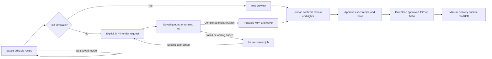

# 03 — Product and user workflows

This chapter describes the product implemented at source commit `1f9415ee19e1e6ed175df6ef8aac8edc7182c9e9`, inspected on 2026-10-24. It is a static source snapshot. It does not establish the current contents of any account, a fresh deployment readback, successful delivery of email, physical-phone behavior or human acceptance. References such as `src/console/Console.tsx:L44-L56` identify private source locations; the source bodies and user records are intentionally absent from this public dossier.

## Product purpose and two content paths

marKER is a private owner workspace for organizing approved product facts and source material, preparing content, reviewing it and exporting files for manual delivery. It currently contains two distinct content paths which share products but have different records, revision counters and approval meanings.

| Path | Main records | Visible location | Delivery artifact | Final action recorded by marKER |
|---|---|---|---|---|
| Studio assembly | Original assets, editable material entries, Studio campaigns and recipe variants | Space and Campaigns | MP4 for multimedia templates; TXT for text template | Approval of an exact recipe/result and a subsequent file download |
| Earlier editorial workflow | Text sources, editorial campaigns and per-account posts | Earlier-record sections and Drafting | Copied text or TXT | Explicit human confirmation that delivery was scheduled or published elsewhere |

Creating an assembly campaign requires a product; it does not require a social account. Registering an account records a manual destination and does not connect a social API. Exporting either kind of content does not post it, start advertising or delete its sources. The current overview states manual social delivery, unconnected OpenAI and paused paid preparation. Sources: `src/console/Console.tsx:L510-L578`, `src/console/Studio.tsx:L275-L286`, `src/console/Studio.tsx:L330-L337`.

### Navigation and initial access

The application uses URL fragments rather than a route library. The recognized fragments are `#overview`, `#products`, `#accounts`, `#space`, `#campaigns`, `#queue` and `#settings`. An unknown fragment resolves to Overview. The user-facing name for `#queue` is **Drafting**, in both language choices. Space and Campaigns mount the Studio component with a different view prop; they do not display the earlier editorial creation flow as the primary workflow. Sources: `src/console/Console.tsx:L36-L56`, `src/console/Console.tsx:L136-L144`, `src/console/Console.tsx:L667-L668`.

At startup, Console asks for session information, then loads the editorial workspace only if authenticated. Before that it shows a loading message, an unconfigured-access message or the login form. The browser supports the current temporary-code flow and a prepared password-flow branch selected by the session response. In code mode, the first submission requests a code; the second submits an eight-digit code. The displayed explanation says five-minute expiry and binding to the browser which requested it. A failed hosted login reveals a separate access-help form. Only submitting that form requests help instructions; opening it does not send mail. Sources: `src/console/Console.tsx:L145-L224`, `src/console/Console.tsx:L299-L368`.

The authenticated initials menu offers Settings and Reload, plus Sign out in hosted mode. Reload refetches saved state. Sign out clears loaded workspace/editor state and reports loss of access to App, which revokes the optional decoration cache. No account email is included in this dossier. Sources: `src/console/Console.tsx:L245-L298`, `src/App.tsx:L27-L35`.

## Shared product facts and manual destinations

### Products

Products are the shared factual reference used by both paths. A product has name, description/approved facts, audience, language, tone, call to action, optional website and a commercial state of preparation, available or paused. The product dialog requires its name; the description is bounded to 5,000 characters, audience/tone/CTA to 1,000 each, language to 80 and website to 2,000. The product state is descriptive; marking a product available does not activate a social provider. Sources: `src/core/domain.ts:L9-L19`, `src/core/domain.ts:L175-L188`, `src/console/Console.tsx:L979-L1056`.

Cards show name, state, facts, audience, language and website. Search matches the product name and description. Edit submits a revision-bound save; Delete shows a confirmation prompt. The domain refuses removal while editorial accounts, sources or campaigns still reference the product. Additional Studio dependencies are handled at the API/repository boundary described in the backend chapters; a browser button is not the authority for deletion. Sources: `src/console/Console.tsx:L582-L623`, `src/core/domain.ts:L190-L202`.

### Accounts

A manual account has a name, one of Instagram/Facebook/TikTok/LinkedIn/X, an HTTP(S) URL without embedded credentials, supported product IDs, IANA timezone and optional language. At least one product must be linked. The default timezone in the form comes from the current browser. The app stores no social password in this form. Sources: `src/core/domain.ts:L1-L8`, `src/core/domain.ts:L20-L28`, `src/core/domain.ts:L131-L140`, `src/core/domain.ts:L204-L245`, `src/console/Console.tsx:L1058-L1121`.

The same account may support multiple products. Its card lists all permitted products and its display timezone. Search matches name/platform; a product filter narrows permitted products. An account with posts cannot be deleted, cannot change platform and cannot unlink a product needed by one of its existing posts. These relationships prevent a later edit from silently reinterpreting a destination. Sources: `src/console/Console.tsx:L624-L665`, `src/core/domain.ts:L224-L252`.

## Space: capture, classification and retained originals

### Capture now, classify later

Space permits video/photo/audio upload, an idea or text entry and browser microphone recording. Product assignment and quick classification are optional at capture. An unassigned material is shared rather than implicitly attached to the currently viewed product. The categories are B-roll, talking to camera, demo, photo, voice note, idea, ready text and testimonial; roles are visual background, narration, main message, hook and CTA. These are manual labels. File metadata does not classify subject matter or determine human speech. Sources: `src/console/Studio.tsx:L13-L15`, `src/console/Studio.tsx:L221-L253`.

The upload ceiling is **250 MiB** per file (`250 × 1024 × 1024` bytes), although some visible UI text abbreviates it as “250 MB.” The browser sends chunks no larger than the smaller of the server-advertised chunk limit and 8 MiB. It remembers an upload session using filename, byte size and last-modified time; selecting the same file again can resume from the server offset. Upload completion registers the immutable asset, then separately creates an editable material entry with conservative defaults: unreviewed, speech unknown and rights unknown. A duplicate original may be reused while a new material entry is created. Sources: `src/core/studio.ts:L8-L12`, `src/console/Studio.tsx:L120-L146`.

Upload and material-entry creation are separate operations. If the original exists without an entry, Space exposes **Recover entry**. Pending uploads show their reported progress and a cancel action. A failed chunk/upload leaves a recoverable session rather than a fabricated completed material. When analysis is active, uploading a new original is blocked by the UI. Sources: `src/console/Studio.tsx:L120-L146`, `src/console/Studio.tsx:L233-L236`.

### Voice notes and interruption

Recording uses `getUserMedia` and `MediaRecorder`, with supported MIME preference WebM/Opus, MP4 or Ogg/Opus. It stops after two minutes or after collected chunks pass a 24 MiB threshold. On stop, microphone tracks are closed, a local File is retained and upload is attempted. If upload fails, the pending recording remains available for explicit retry, local download or discard. Navigation is held while recording or while an unsaved recording remains; a before-unload warning is installed. Component cleanup closes tracks and cancels its recording timer. This is a browser flow, not a background/native mobile recorder. Sources: `src/console/Studio.tsx:L83-L100`, `src/console/Studio.tsx:L148-L167`, `src/console/Studio.tsx:L229-L234`, `src/console/Console.tsx:L136-L143`.

### Material maintenance

An editable entry can contain a short title, idea/text, description, comma-separated topics, multiple products/categories/roles, review state, manually declared speech presence, usage rights, restrictions and an optional useful interval. Asset-backed entries preserve their original link; text/idea entries do not receive a multimedia asset. Rights choices are unknown, owned, licensed or restricted. “No speech” remains different from “no audio track.” Sources: `src/console/Studio.tsx:L168-L177`, `src/console/Studio.tsx:L238-L255`, `src/core/studio.ts:L173-L216`.

The library filters by title/text/description/topics, product/shared assignment, category and review/used state. Cards expose a compatible browser preview, original download, technical dimensions/duration/MIME/audio-track information, processing compatibility, usage count and content version. Unsupported processing formats may still have an original retained; a stored file is not proof it can render. A referenced entry cannot be deleted. Usage display includes current variants and preserved completed-render references. Sources: `src/console/Studio.tsx:L183-L187`, `src/console/Studio.tsx:L257-L273`, `src/core/studio.ts:L143-L146`, `src/core/studio.ts:L353-L360`.

The user may select up to 50 entries and choose **Prepare campaign from selection**. Space and Campaigns reuse the same mounted Studio state, so that selection can seed the proposal panel. Selecting candidates does not automatically approve their rights or mark them ready. Earlier text sources can be copied into independent editable Studio entries; copying preserves an origin reference and initializes rights as unknown. It does not migrate or delete the earlier source. Sources: `src/console/Studio.tsx:L263-L273`, `src/console/Studio.tsx:L289-L290`.

## Campaigns: editable assembly before rendering

### Create campaign and choose a recipe

The Studio campaign form takes product, name, objective and organic/paid mode. A saved campaign can be reopened; name/objective remain editable. A campaign with variants retains its product. The UI can create a new piece or select an existing variant by platform, template and recipe revision. Paid mode is explicitly displayed as paused. There is no ad activation action in this workflow. Sources: `src/console/Studio.tsx:L275-L288`, `src/core/studio.ts:L361-L374`.

Five templates exist: text overlay reel, narrated demo, tips, motivation and text post. The platform remains a declared intended destination, not an account connection. Manual recipe editing supports shared materials and materials assigned to the campaign's product. It keeps selected sources visible even when a filter would otherwise hide them. Sources: `src/core/studio.ts:L8-L15`, `src/console/Studio.tsx:L184-L185`, `src/console/Studio.tsx:L291-L302`.

### Deterministic proposals

The proposal panel is a rule-based assistant over selected material and manually developed copy. The user chooses up to 50 candidates, explicitly allows shared entries when needed, chooses duration/platform/template, writes hook/body/CTA or selects ready text literally, and may lock source intervals in relative order. It can return a main proposal and up to two alternatives, each with reasons, warnings, source/version provenance and exclusions. Proposing does not render a video or reserve processing credit. Sources: `src/console/StudioPlanner.tsx:L23-L31`, `src/console/StudioPlanner.tsx:L62-L101`, `src/console/StudioPlanner.tsx:L124-L154`, `src/core/studio-planner.ts:L122-L211`.

Automatic selection requires suitable ready material and adequate rights. Talking clips and demos need human-reviewed ranges; licensed entries and entries with restrictions require review for the piece. Muting backgrounds requires an explicit permission separate from a speech declaration. The user can deliberately allow previously used intervals. A technical signal never promotes material into a semantic category. Sources: `src/console/StudioPlanner.tsx:L124-L141`, `src/core/studio-planner.ts:L122-L211`.

Proposal generation snapshots the request and Studio revision. Editing the request or refreshing to a changed Studio revision invalidates application of that visible result. It stays visible for comparison, but the user must propose again. Replacing an existing visible proposal and replacing unsaved manual recipe edits each require their own acknowledgment. Apply sends request, fingerprint, alternative and expected revision; the server recomputes against current sources before saving an editable variant. No client-supplied “approved plan” is trusted as authority. Sources: `src/console/StudioPlanner.tsx:L54-L94`, `src/console/StudioPlanner.tsx:L142-L154`, `src/console/Studio.tsx:L204-L213`, `src/core/studio.ts:L379-L394`.

### Manual recipe and revision lifecycle

The manual editor permits at most three visual segments, including multiple retained segments of the same material. It records hook/body/CTA, total duration, contain/cover framing, horizontal/vertical focus, original sound mute/keep and an optional recorded narration. Narration replaces original sound. Visual intervals must total the saved duration of 5–60 seconds; the renderer does not silently loop, freeze or trim a mismatched recipe. A narrated demo requires adequate narration or confirmed retained speech. Overlays are not synchronized subtitles. Sources: `src/console/Studio.tsx:L188-L202`, `src/console/Studio.tsx:L291-L317`, `src/core/studio.ts:L298-L332`.

The recipe form allows up to 3,000 body characters, while render preflight applies the tighter visual-overlay limits of 900 body characters and 160 for hook/closing. An editable draft may therefore require copy reduction before rendering. A new piece uses the server's configured default duration, falling back to 20 seconds; an existing piece keeps its saved duration. Sources: `src/console/Studio.tsx:L304-L309`, `src/core/studio.ts:L292-L296`, `src/console/Settings.tsx:L63-L64`.

Unsaved form fields are held in session storage, not silently persisted to the server. The recipe draft includes its base recipe revision. If recovered against a newer revision, the UI asks the user to compare with the saved preview and explicitly confirm saving over the current version. A changed saved recipe increments its revision, resets review to draft and requires a corresponding new review; an identical save preserves its existing approval and revision. A source-snapshot refresh is an explicit recipe choice. Sources: `src/console/Studio.tsx:L17-L47`, `src/console/Studio.tsx:L197-L201`, `src/console/Studio.tsx:L315-L322`, `src/core/studio.ts:L237-L278`.

### Render, review, approve and export

Unsaved recipe edits block render, approval and export. A multimedia preview is requested explicitly and jobs are polled while queued/running. A completed job for the exact recipe can be reviewed without another render; a separate regeneration acknowledgment is required to request another processing attempt. The UI offers a saved queued-job resume path. A failure or prolonged wait is not converted into success, approval or an automatic new paid attempt. Sources: `src/console/Studio.tsx:L101-L111`, `src/console/Studio.tsx:L319-L328`.

Approval requires a review/rights checkbox and exact recipe revision. Multimedia approval also names the completed job; the domain requires a trusted completed render of that revision. Text uses its saved text preview. Approved export checks the current recipe and approved job again. Changed rights, source versions, recipe text or a mismatched result can invalidate eligibility even if an old result exists. Source snapshots and job history remain inspectable. Sources: `src/console/Studio.tsx:L330-L337`, `src/core/studio.ts:L280-L296`, `src/core/studio.ts:L335-L344`, `src/core/studio.ts:L395-L408`.

## Optional technical analysis

The technical-aids panel is available in both Studio views. It lists compatible video/audio originals and can retrieve saved analyses even when new analysis is unavailable. New requests require the server's analysis capability, explicit confirmation and up to three sequential intervals, each at most 120 seconds and inside the original. The UI displays maximum internal-credit reservation, cache reuse and the fact that compute failures consume credit. Sources: `src/console/StudioAnalysis.tsx:L25-L48`, `src/console/StudioAnalysis.tsx:L74-L93`.

Results can contain technical thumbnails, possible scene transitions, low audio energy, dark-image intervals and low visual variation. The panel displays analyzed coverage, tool/profile and partial/unavailable warnings. It does not recognize topics, transcribe words, label B-roll or infer speech from silence. Choosing a signal interval is a human action; the planner then asks which material entry for that original is intended and explicitly attaches the analysis/range. Sources: `src/console/StudioAnalysis.tsx:L94-L106`, `src/console/StudioPlanner.tsx:L113-L119`.

The source UI displays a remote-tool-verification notice when analysis capability is false, and manual proposals remain usable. Polling a requested analysis ends after its bounded wait, leaves the saved job available and never automatically requests another analysis. This dossier does not claim new hosted analysis is active. Sources: `src/console/StudioAnalysis.tsx:L47-L72`, `src/console/StudioAnalysis.tsx:L77-L78`.

## Drafting and earlier editorial records

Earlier text sources and campaigns remain separately displayed under Space and Campaigns. Existing sources can be read and, while unused by campaigns, edited/deleted. Existing campaigns can open their drafts in Drafting and be deleted only after dependent posts are explicitly removed. The code retains legacy source/campaign creation forms and domain commands, but current primary **New** buttons only open product/account dialogs; this snapshot does not claim a visible top-level button creates new legacy campaigns. Sources: `src/console/Console.tsx:L435-L447`, `src/console/Console.tsx:L669-L779`, `src/console/Console.tsx:L1123-L1263`.

Drafting filters earlier posts by free text, product, account and a seven-day period interpreted in each account's timezone. Card dates are displayed in that timezone. Proposed-time input uses the current computer's timezone and is converted into an absolute ISO timestamp. Two posts for the same account cannot have exactly the same absolute scheduled time, including across products. Unscheduled drafts disappear when the week filter is active. Sources: `src/console/Console.tsx:L377-L406`, `src/console/Console.tsx:L484-L505`, `src/console/Console.tsx:L1296-L1328`, `src/core/domain.ts:L376-L392`.

| Editorial state/action | Preconditions | Effect |
|---|---|---|
| Draft | Existing campaign/account relationship | Editable text and optional proposed time |
| Ready | Nonempty copy and explicit format review; compatible text destination | Records readiness for manual delivery |
| Copy / TXT export / Open network | Copy/export requires nonempty text | Copies/downloads or opens a URL; status remains unchanged |
| Confirm scheduled/published | Ready organic post, evidence HTTP(S) URL and explicit checked confirmation | Records the human-reported external result |
| Retire and delete | Explicit deletion confirmation | Deletes that post's text/record; campaign source references remain |

Instagram/TikTok text-only posts cannot be marked ready in this earlier path. Paid campaigns cannot confirm a delivery/spend outcome. Scheduled/published posts cannot be edited through ordinary post save; their evidence is preserved until the separate explicit removal action. Sources: `src/console/Console.tsx:L780-L855`, `src/console/Console.tsx:L1329-L1376`, `src/core/domain.ts:L369-L442`.

The development-only local text simulation appears inside Drafting only when the build is DEV and the session mode is local. The user selects product → campaign → draft → campaign sources, reviews/edits a marked simulated response, then explicitly saves it as a draft through the existing editorial command and revision check. Results expire after five minutes; a reload/unmount clears the simulation. It is not an OpenAI connection and does not become production AI because an AI allocation is saved. Sources: `src/console/Console.tsx:L32-L34`, `src/console/Console.tsx:L780-L784`, `src/console/TextSimulation.tsx:L25-L82`, `src/core/generation.ts:L5-L12`, `src/core/generation.ts:L164-L183`.

## Settings and device preferences

Owner-saved Settings contain five integer values: total internal monthly cents, monthly processing cents, future AI cents, storage bytes and default duration seconds. Initial values are US$20 / US$10 / US$0, 2 GiB and 20 seconds. Each monetary allocation is bounded by US$20, processing plus AI must fit within total, storage is at most 2 GiB and duration is a whole number from 5 through 60. The frontend parses decimal dollars into cents; the shared domain validates the same contract. These are internal admission/planning limits, not an external invoice hard cap. Sources: `src/core/settings.ts:L3-L38`, `src/console/Settings.tsx:L47-L54`, `src/console/Settings.tsx:L69-L85`.

Settings load from the server and preserve unsaved fields in session storage with their base settings revision. Refresh can retain fields; Restore replaces them with saved values. A stale save is not silently rebased. After refreshing, the user compares the current values and explicitly confirms replacement against the newly observed revision. Lowering limits preserves files/usage; changing default duration does not rewrite existing recipes. Future AI allocation does not connect a provider. Sources: `src/console/Settings.tsx:L18-L64`, `src/console/Settings.tsx:L84-L90`.

Environment controls are shared between the top quick panel and Settings: interface language, companions enabled, pause, scene selector/playback and optional decorative asset copy. Language persists in this browser; animation/cache choices apply to the current visit. Content remains in its original language. Reduced-motion preference forces a static composition. Help is accessible at the lower left of each module and editor; the authenticated Environment help section traverses the full guide. Sources: `src/App.tsx:L48-L77`, `src/console/EnvironmentSettings.tsx:L11-L20`, `src/i18n.tsx:L336-L345`, `src/console/Console.tsx:L865-L874`, `src/console/Help.tsx:L139-L190`.

## Questions a detached reviewer should preserve

1. Is a proposed change about Studio recipes or earlier per-account posts? Identify the records and revision boundary before suggesting a migration.
2. Does a new automation merely propose, or does it write/render/approve/export/deliver? Each is a separate existing action.
3. How are pending recordings, interrupted uploads, recovered form fields and concurrent device edits preserved?
4. Does the proposal preserve exact recipe/source/result approval and manual rights decisions?
5. Does the UI distinguish internal credits from actual provider charges and inactive AI from usable inference?
6. What new runtime, phone and human evidence would be required? Existing source/tests alone do not supply it.

See [frontend implementation](04-frontend-and-interaction.md), [browser/editorial nodes](code-flow/02-browser-and-editorial.md) and [animation/help nodes](code-flow/04-animation-and-help.md).
