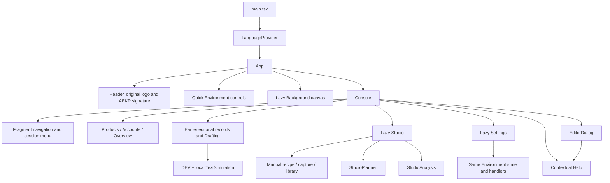

# 04 — Frontend and interaction architecture

Pinned source: `1f9415ee19e1e6ed175df6ef8aac8edc7182c9e9`; inspected 2026-10-24. This is an implementation description derived from tracked code, not a current browser capture or an assertion that every device flow passed. Private source references are locators for the owner; this public package does not reproduce those source bodies.

## Entry, ownership and component tree

The browser is a React/TypeScript single-page app. `main.tsx` imports the global, console and release styles, then renders StrictMode → LanguageProvider → App. App owns the identity/header, Environment preferences, access-sensitive decorative cache and lazy Background; Console owns session discovery, editorial data, navigation and editor dialogs. Studio and Settings are lazy-loaded feature components. Sources: `src/main.tsx:L1-L9`, `src/App.tsx:L1-L25`, `src/console/Console.tsx:L29-L56`.

| Owner | State and responsibility | Does not own |
|---|---|---|
| LanguageProvider | EN/ES preference, translation function and document language | Translation of saved user content |
| App | Authentication mirror, enabled/pause/cache/playback/scene state and layout identity | Workspace business records or approval decisions |
| Console | Session response, editorial Workspace, tab/editor, filters, shared command busy/error/status | Studio's separate record state or processing jobs |
| Studio | Studio API response, library/campaign/variant selection, upload/recording, recipe draft and job UI | Provider inference, social delivery or sole authority over rights |
| StudioPlanner | Candidate request, proposal snapshots, alternatives, replacement confirmations | Persistent recipe until Apply succeeds |
| StudioAnalysis | Queued intervals, explicit confirmation, polling and displayed analysis history | Semantic labels, speech detection or automatic edits |
| Settings | Server settings response, recovered fields/base revision, conflict acknowledgment | Provider billing plan or AI activation |
| HelpDialog | Current guide step, modal lifecycle and focus restoration | Operational execution of any described step |

Sources: `src/App.tsx:L12-L53`, `src/console/Console.tsx:L106-L168`, `src/console/Studio.tsx:L57-L106`, `src/console/StudioPlanner.tsx:L20-L60`, `src/console/StudioAnalysis.tsx:L22-L41`, `src/console/Settings.tsx:L15-L37`, `src/console/Help.tsx:L150-L173`.

## Routing and rendering boundaries

The fragment parser accepts exactly seven tab IDs; it falls back to Overview. State changes synchronize `location.hash` with `history.replaceState`, and a `hashchange` listener updates the selected tab. A recording/pending-recording guard restores the previous fragment instead of leaving the Studio view. Navigation buttons for other tabs are disabled under that guard. This is a view switch in one React tree, not a server route or persisted navigation stack. Sources: `src/console/Console.tsx:L36-L56`, `src/console/Console.tsx:L127-L144`, `src/console/Console.tsx:L414-L429`.

The same Studio component occupies the same child position when switching between Space and Campaigns. Its view prop changes, retaining candidate selections and other local Studio state across that switch. Leaving for a different module unmounts Studio; durable server data remains, while selected IDs and local component state are not a cross-device selection service. Session-storage drafts can be recovered when their relevant form remounts. Source: `src/console/Console.tsx:L667-L668`, `src/console/Studio.tsx:L73-L98`, `src/console/Studio.tsx:L263-L289`.

The current top-level create buttons are rendered only for Products and Accounts. Legacy source/campaign dialog branches still exist, and earlier data remains usable, but their presence in the code is different from current visible navigation reachability. Detached proposals should not use old screenshots or old workflow descriptions to infer a current “New editorial campaign” button. Sources: `src/console/Console.tsx:L435-L447`, `src/console/Console.tsx:L669-L779`, `src/console/Console.tsx:L1123-L1263`.

Console uses Suspense fallbacks while loading Studio and Settings. TextSimulation is conditionally declared only in DEV and mounted only for a local session in Drafting. Background is lazy after App's short ready delay and is removed when companions are disabled. The lazy declaration alone is not a capability grant; the server still decides access and operation availability. Sources: `src/App.tsx:L9-L25`, `src/App.tsx:L55-L58`, `src/console/Console.tsx:L32-L34`, `src/console/Console.tsx:L667-L668`, `src/console/Console.tsx:L780-L784`.

## Session loading and browser API boundaries

The shared client explicitly sends same-origin credentials and `cache: no-store`. A supplied body changes the request to JSON POST and adds the existing authentication marker header; without a body it uses GET. It parses JSON then converts non-success responses into errors, with friendly mappings for selected auth failures. `sendCommand` includes the current editorial revision. `exportText` creates a temporary local Blob URL, triggers a download and revokes the URL after one second. Sources: `src/core/client.ts:L1-L33`.

Studio has a separate small JSON fetch wrapper under `/api/studio`; it returns parsed response bodies or throws the API error. It uses GET when no body is supplied, JSON POST normally and explicitly supports DELETE for cancellation. Binary upload chunks use separate PUT requests carrying an offset header. Browser download/media URLs go through authenticated application routes, not an exposed storage bucket URL. Sources: `src/console/Studio.tsx:L16-L16`, `src/console/Studio.tsx:L49-L55`, `src/console/Studio.tsx:L120-L146`, `src/console/Studio.tsx:L235-L236`, `src/console/Studio.tsx:L325-L336`.

| Browser action | Request shape | Response ownership / UI consequence |
|---|---|---|
| Discover access | GET `/api/session` | Session mode, authenticated/configured state and flow choice |
| Load editorial records | GET `/api/workspace` | Replaces Console Workspace after authenticated discovery |
| Save editorial command | POST `/api/commands` with revision/type/data | Replaces Console Workspace only after success |
| Request/verify access or access help | POST under `/api/auth/` | Login/help status; refresh after verification |
| Read Studio | GET `/api/studio` | Separate Studio state, jobs, uploads, capabilities and usage |
| Save Studio command | POST `/api/studio/commands` with expected revision and command | Updates Studio state; not Console's editorial revision |
| Prepare deterministic plan | POST `/api/studio/plan` | Proposal for review; no persisted recipe until Apply |
| Upload original | POST upload session, offset PUT chunks, POST complete | Asset registration followed by material-entry command |
| Render | POST variant render with recipe revision/regeneration choice | Saved job; polling observes progress |
| Approve | POST variant approval with recipe revision, selected job and confirmation | Updated state; export link may become eligible |
| Read/save settings | GET/POST `/api/studio/settings` | Separately revisioned shared owner settings |

Sources: `src/console/Console.tsx:L145-L224`, `src/core/client.ts:L21-L23`, `src/console/Studio.tsx:L99-L117`, `src/console/Studio.tsx:L120-L146`, `src/console/Studio.tsx:L204-L213`, `src/console/Studio.tsx:L289-L341`, `src/console/Settings.tsx:L26-L64`.

The frontend does not optimistically declare saves successful. Shared command handlers clear their own errors/status, await the response and replace state on success. A rejected command leaves the dialog/form visible. The UI's error presentation is not an alternative persistence mechanism: a failed HTTP response does not authorize replay or fabricate server state. Sources: `src/console/Console.tsx:L169-L184`, `src/console/Console.tsx:L935-L957`, `src/console/Studio.tsx:L107-L117`.

## Revisions, forms and recovery

There are four relevant concurrency identities: editorial Workspace revision, Studio state revision, each variant's recipe revision and settings revision. They are not interchangeable. A plan also has a request fingerprint and source provenance; a render/approval is tied to a specific recipe/result. A refactor which reuses “the current revision” across modules would collapse distinct consistency boundaries. Sources: `src/core/domain.ts:L60-L68`, `src/core/studio.ts:L50-L65`, `src/core/settings.ts:L9-L14`, `src/console/Studio.tsx:L113-L117`, `src/console/StudioPlanner.tsx:L54-L94`.

### Editorial dialogs

EditorDialog uses a real modal `<dialog>`. On mount it records previous focus and calls `showModal`; cancel is prevented while a save is busy, and unmount restores focus. It collects normal form values plus explicit arrays/checkbox booleans, derives the command type and closes only after `save()` reports success. This dialog does not implement general session-storage recovery for product/account/post forms. Sources: `src/console/Console.tsx:L880-L957`.

Legacy TXT/MD import checks extension and byte size, decodes UTF-8 with fatal errors, rejects over 64,000 characters or NUL and displays the material as escaped text rather than executing Markdown HTML. A separate declared material date is not substituted for the recorded entry date. Sources: `src/console/Console.tsx:L1123-L1188`, `src/core/domain.ts:L255-L283`.

### Studio draft forms

DraftForm wraps otherwise uncontrolled native controls. Named-field changes serialize form values into session storage; on remount it restores text/select values and checkbox selections. Optional storage failure leaves visible controls usable. Recipe forms carry a base revision; recovery against a different revision shows an acknowledgment to compare against saved work. Recovery changes fields, not server state. Success handlers remove the corresponding local draft. Sources: `src/console/Studio.tsx:L17-L47`, `src/console/Studio.tsx:L168-L177`, `src/console/Studio.tsx:L197-L201`.

Manual recipe dirty state prevents render, approval and download links. While dirty, the saved text remains visible for comparison. This prevents an export button from silently exporting an older saved message while the user is looking at edited fields. Source: `src/console/Studio.tsx:L319-L334`.

### Planner and Settings recovery

Planner uses controlled request fields saved under a campaign/variant session key. The visible proposal is a separate snapshot, so current input equality and Studio revision equality can be checked before Apply. A reloaded draft is restored as fields and must be proposed against current material again. Replacement of unsaved manual recipe fields requires an additional explicit acknowledgment. Sources: `src/console/StudioPlanner.tsx:L23-L60`, `src/console/StudioPlanner.tsx:L77-L102`, `src/console/StudioPlanner.tsx:L142-L154`.

Settings also uses controlled strings rather than converting every keystroke into an integer. On save it validates dollar precision, integer cents, allocation sum, byte ceiling and duration. It preserves a recovered settings revision, distinguishes dirty from stale and does not silently replace the draft on refresh. Explicit current-value acknowledgment is necessary for a stale overwrite after refresh. Source: `src/console/Settings.tsx:L7-L64`, `src/console/Settings.tsx:L84-L90`.

### Persistence/lifetime map

| Data | Browser storage/lifetime | Server effect |
|---|---|---|
| UI language | Local storage; browser preference | None |
| Upload session locator | Local storage keyed by file metadata; removed after completion/error reset | Resume reads authoritative server offset |
| Material/campaign/recipe draft fields | Session storage; explicit save handlers remove applicable draft | None until command succeeds |
| Planner input draft | Session storage; proposal result itself stays component memory | Apply is an explicit server command |
| Unsaved Settings fields/base revision | Session storage; cleared after successful save or clean comparison | None until settings CAS succeeds |
| Pending voice recording | Component memory + temporary Blob URL | Upload is attempted; failure retains local file while mounted |
| Simulation requests/results | Component-owned in-memory simulator; bounded expiry | Only explicit ordinary draft save |
| Decorative optional copy | Cache Storage after explicit consent; memory otherwise | Static asset fetch only |

Sources: `src/i18n.tsx:L336-L345`, `src/console/Studio.tsx:L17-L47`, `src/console/Studio.tsx:L83-L100`, `src/console/Studio.tsx:L124-L146`, `src/console/StudioPlanner.tsx:L33-L58`, `src/console/Settings.tsx:L10-L37`, `src/console/TextSimulation.tsx:L14-L36`, `src/decoration/assets.ts:L22-L66`.

Sign out explicitly revokes the decorative copy through App. Do not infer that this decoration cleanup also clears every form/upload/language storage key; those are separate code paths. This map documents current storage behavior and contains no stored user content. Sources: `src/App.tsx:L27-L43`, `src/console/Console.tsx:L255-L270`.

## Asynchronous work and busy states

Console has an editorial command busy flag and separate access-help busy flag. Studio has its own action busy flag, active-job observation, analysis-active state and recorder/pending-recording state. Settings and Planner have their own busy/pending guards. These flags provide UI coordination, while server revision/admission checks enforce cross-device correctness. The frontend does not turn local disabled controls into a cross-client lock. Sources: `src/console/Console.tsx:L109-L135`, `src/console/Studio.tsx:L62-L111`, `src/console/StudioPlanner.tsx:L45-L49`, `src/console/Settings.tsx:L22-L24`.

Queued/running renders are polled every 1.6 seconds. Technical analysis submits a confirmed list sequentially; each job is polled at the same interval with a 270-second UI waiting deadline. An unmount stops further polling through a mounted flag; it does not invent cancellation of an already accepted server compute job. On timeout/failure the user is told to check saved history before another request. Sources: `src/console/Studio.tsx:L101-L106`, `src/console/StudioAnalysis.tsx:L35-L72`.

Upload is blocked during analysis; render is blocked during active compute/analysis and unsaved recipe edits. Recording disables conflicting capture/navigation actions and preserves failed-upload local audio. The server remains responsible for atomic admission, budget/storage reservation, actual compute and results. Sources: `src/console/Studio.tsx:L107-L123`, `src/console/Studio.tsx:L229-L235`, `src/console/Studio.tsx:L325-L332`, `src/console/Console.tsx:L418-L424`.

## Localization, styles, identity and accessibility

The i18n table maps Spanish source strings to English; Spanish returns the source text. Selected dynamic validation messages have regular-expression translations. Missing translations fall back to the original string. Newer Studio/Planner/Analysis/Settings components also use explicit bilingual inline copy. LanguageProvider defaults to English, updates document `lang` and persists EN/ES; this does not translate material or product facts. Sources: `src/i18n.tsx:L321-L351`, `src/console/Studio.tsx:L57-L61`, `src/console/Settings.tsx:L15-L17`.

Styles are layered: global typography/layout, console structure, then release-level shared visual rules; feature CSS accompanies Studio/Settings/Help. The supplied self-hosted Montserrat variable fonts use medium body weight and extra-bold headings; the approved logo is displayed as the original image with its intrinsic aspect ratio. The fixed lower-left signature is separate from the noninteractive lower-right decoration. Sources: `src/main.tsx:L5-L7`, `src/style.css:L1-L55`, `src/App.tsx:L73-L78`, `src/console/release.css:L135-L138`.

Native checkboxes receive a shared rectangular switch track and dark protruding thumb through `release.css` tokens. The checked track uses the brand orange. Selected module/primary actions use orange/charcoal rules; a later selected-navigation rule retains bold emphasis for that specific surface. A reviewer should inspect CSS cascade rather than infer all controls have identical font weight. Forced-colors styles and focus-visible outlines are present. Sources: `src/console/release.css:L1-L12`, `src/console/release.css:L71-L130`, `src/console/release.css:L147-L152`.

Forms use native labels, required/min/max constraints, fieldsets and explicit review controls. Error/status messages use alert/status roles; active module uses `aria-current`; piece/alternative selection uses pressed state. Help/editor dialogs restore focus, and Help focuses the current step heading. Decoration is `aria-hidden`, inert and pointer-transparent. These are implemented accessibility affordances, not a claim of a completed accessibility audit. Sources: `src/console/Console.tsx:L85-L100`, `src/console/Console.tsx:L414-L455`, `src/console/Console.tsx:L920-L933`, `src/console/Help.tsx:L164-L190`, `src/decoration/Background.tsx:L123-L124`, `src/style.css:L54-L55`.

Responsive CSS adapts Studio filters/source controls, Settings grids, Help dialogs and branding around small viewports. Native file/media controls and microphone permission remain browser-dependent. Responsive source rules and synthetic viewport tests cannot prove physical iPhone/Android capture, codec support, interruption or microphone behavior. Sources: `src/console/studio.css:L52-L55`, `src/console/settings.css:L10-L10`, `src/console/help.css:L98-L102`, `src/console/Studio.tsx:L148-L166`.

## Source-level verification hooks and review seams

Existing tests cover bilingual Help declarations, screenshot references and text-only guide rendering; editorial domain transitions/concurrency; local simulation expiry/cancellation/staleness; deterministic scene geometry; scheduler pause/no-repeat; and cache consent/races/bounds. Those test files were inspected for this dossier, not rerun as product validation. Relevant locators: `tests/ui-help.test.ts:L17-L69`, `tests/editorial.test.ts:L63-L336`, `tests/generation.test.ts:L33-L139`, `tests/motion.test.ts:L10-L99`, `tests/scheduler.test.ts:L13-L36`, `tests/assets.test.ts:L14-L40`.

Useful change seams are the existing shared domain contracts, command clients, exact-revision result checks, Environment prop boundary, LanguageProvider and shared checkbox CSS. A proposal should name changes across caller, domain, server and tests where applicable. A UI-only change cannot safely redefine rights, budget admission, source identity or approval by changing a disabled attribute or client label. See [browser/editorial flow](code-flow/02-browser-and-editorial.md) and [decoration/help flow](code-flow/04-animation-and-help.md).
