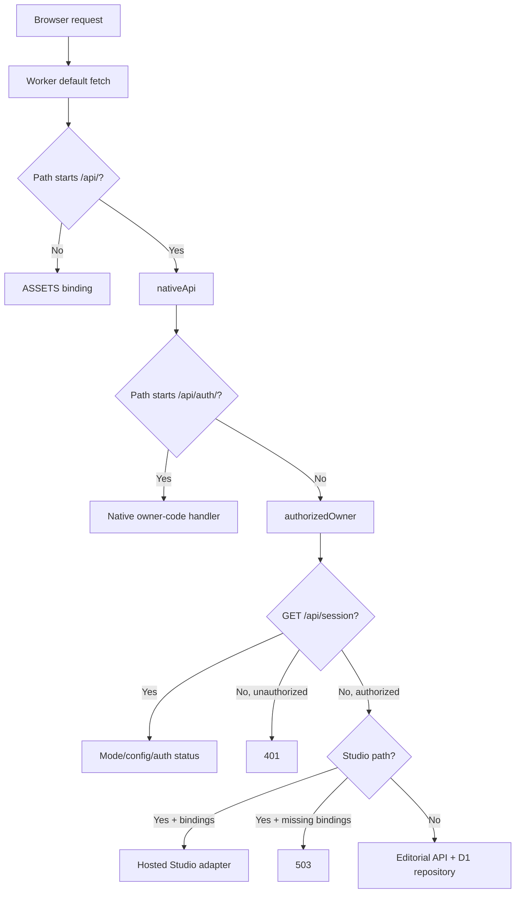

# 05 — Backend API and access

Pinned source: `1f9415ee19e1e6ed175df6ef8aac8edc7182c9e9`. The API is private to one configured owner. Static frontend delivery is public; business data and media routes require owner authorization. This chapter describes code contracts, not a fresh production login or provider test.

## Request dispatch and adapter selection

| Node | Responsibility and implementation |
|---|---|
| Worker default fetch | Static asset fallback vs API dispatch; scheduled event purges expiring auth records. `server/worker.ts:L106-L113`. |
| Native API | Auth routes bypass the existing-session requirement so code login can begin; every other data/Studio route verifies owner session. `server/worker.ts:L115-L128`. |
| D1 repository | Single editorial document with CAS and Studio dependency guards. `server/d1.ts:L3-L24`. |
| Hosted Studio | Requires both private-media and processor bindings; each request receives the current editorial workspace. `server/worker.ts:L121-L125`. |
| Alternative `hostedApi` | Exported Supabase password/token adapter, not called by the default Worker fetch. `server/worker.ts:L16-L105`. Presence in source is not current activation. |

Configured binding roles are: `ASSETS` for built frontend/font resources, `DB` for D1, `EMAIL` for login/help mail, `MEDIA` for private R2, and `STUDIO_PROCESSOR` for the owner-named durable processor. Auth configuration supplies canonical origin, one owner address, a sender and an HMAC secret. Instance IDs, concrete addresses and secrets are deliberately absent from this repository. Sources: `server/worker.ts:L109-L125`, `server/native-auth.js:L69-L83`, `server/studio-hosted.ts:L14-L25`, `server/studio-processor.ts:L216-L229`.

## Native owner-code authentication

All four `/api/auth/*` endpoints accept POST only. Unknown auth path →404; wrong method →405 with `Allow: POST`. Auth responses are JSON, private/no-store, nosniff, no-referrer and noindex/nofollow. They require the canonical application origin in both URL and `Origin`, plus `X-Marker-Auth: 1`; otherwise 403 `ORIGIN_NOT_ALLOWED`. Invalid/missing configuration returns 503 `AUTH_UNAVAILABLE`. Configuration accepts exactly one normalized owner address, a valid sender, an HMAC secret of 32–512 UTF-8 bytes without CR/LF, usable email and database bindings, and the canonical product HTTPS origin. Sources: `server/native-auth.js:L4-L16`, `server/native-auth.js:L42-L83`, `server/native-auth.js:L128-L137`.

Auth JSON parsing requires JSON with optional UTF-8 charset, an object, ≤512 bytes and a three-second stream deadline. Invalid data returns 400; overlimit returns 413; stalled body returns 408 `REQUEST_TIMEOUT`; unexpected service failures return 503. Duplicate or malformed token cookies are rejected. Sources: `server/native-auth.js:L52-L58`, `server/native-auth.js:L86-L116`, `server/native-auth.js:L208-L211`.

| Route | Input | Success/effect | Negative/failure behavior |
|---|---|---|---|
| `POST /api/auth/request` | Exactly `{email:string}`; normalized valid address ≤254 chars; trusted edge connecting-IP header. | 202 generic acknowledgement plus challenge cookie. For the known owner, persist challenge then schedule email with an eight-digit PIN. | Unknown addresses receive the same generic response and quota treatment. Global/IP quota →429. Cooldown/owner quota returns generic acknowledgement without fresh mail. Delivery failure logs a fixed message and revokes that challenge; it does not convert the HTTP response into owner enumeration. |
| `POST /api/auth/verify` | Exactly `{code:string}` of eight digits, challenge cookie from same browser. | 200 `{ok:true}`, opaque owner session cookie and cleared challenge cookie. | Missing/invalid/expired/consumed/locked or wrong-browser challenge →401 `INVALID_CODE`; fifth valid attempt may succeed, sixth cannot. Challenge consumption/session creation is one batch. |
| `POST /api/auth/logout` | Empty `{}`. | 200 `{ok:true}`; revoke presented session/challenge hashes and clear both cookies. | Extra JSON fields →400; database/config failure →503. |
| `POST /api/auth/help` | Exactly `{email,language}`, language `en/es`; valid address and trusted edge IP. | 202 generic acknowledgement; only authorized address may receive fixed access instructions. | Separate HMAC-namespaced help quotas; global/IP rate →429, cooldown generic. Does not create a challenge/session, clean auth state or authorize data access. |
| `GET /api/session` | Session cookie optional. | Hosted mode, configuration boolean, authenticated boolean, `authFlow:"code"`; user email only if authenticated. | It is status discovery, not a grant or a separate credential. Other private routes return 401 without a valid owner session. |

Sources: `server/native-auth.js:L139-L207`, `server/worker.ts:L117-L120`.

Tokens are random 32-byte values encoded as 43 URL-safe characters. PIN generation uses rejection sampling across 100 million values. Stored email/challenge/code/session/limit identifiers are purpose-namespaced HMAC-SHA256 values; raw tokens and PINs are not the D1 auth keys. Challenge cookie `__Host-marker_challenge` lasts five minutes; `__Host-marker_session` has a six-hour absolute maximum. Both use `Path=/; Secure; HttpOnly; SameSite=Strict`. Server session validation requires matching owner hash, canonical URL origin, unexpired absolute lifetime and last activity within 30 minutes; successful checks update activity. Sources: `server/native-auth.js:L9-L14`, `server/native-auth.js:L49-L83`, `server/native-auth.js:L118-L125`, `server/native-auth.js:L163-L202`, `server/native-auth-store.js:L112-L140`.

Auth admission allows up to 100 global requests/hour, 10/IP/hour and five challenges/owner namespace/hour, with at least 60 seconds between fresh owner requests, at most 30 known-owner challenges/day and at most 100 outstanding challenge rows. The SQL tests the prior count below each ceiling before admitting the next operation. Unknown and cooldown calls still consume IP/global allowance. Help has separately namespaced analogous global/IP/owner/day counters, not challenge creation. Expiry cleanup removes expired challenges, sessions past absolute/idle limits and old limiter windows; scheduled cleanup is also wired. Sources: `server/native-auth-store.js:L8-L104`, `server/worker.ts:L107-L107`.

## Editorial API contract

JSON replies have no-store and nosniff headers. Shared JSON reading requires `application/json`, consumes at most 300,000 bytes unless explicitly overridden, requires a body, decodes strict UTF-8 and validates JSON. Wrong content type →415; empty/overlimit body →413; malformed JSON →400. A client cannot replace the workspace wholesale through this API; it submits commands. Sources: `server/api.ts:L7-L55`.

| Route | Request | Success | Failure |
|---|---|---|---|
| `GET /api/workspace` | Owner session. | 200 full editorial `Workspace`. | Repository service failure →503 safe message. |
| `POST /api/commands` | `{revision:integer,type:string,data:object}`; if `Origin` present it must equal request URL origin. | 200 next workspace after domain validation and repository CAS. | Invalid →400; domain not found →404; stale revision/storage race/dependency →409; foreign origin →403; unknown route/method →404; unexpected store failure →503. |

Sources: `server/api.ts:L56-L96`; field/command contracts: [02](02-data-model-and-transactions.md).

The native session's canonical origin check and strict cookies wrap editorial calls. Unlike Studio mutations, `editorialApi` itself does not require a missing `Origin` header to be added; it rejects a supplied foreign origin. This is the actual code distinction, not an assumption that all handlers share one CSRF guard. Sources: `server/native-auth.js:L118-L125`, `server/api.ts:L66-L68`, `server/studio-hosted.ts:L540-L545`.

## Studio common contract

Hosted Studio validates URL origin, supplied Origin, and cross-site Fetch Metadata; mutations require the canonical Origin header. Only GET/POST/PUT/DELETE are admitted; other methods →405 `method_denied`. IDs match 1–100 alphanumeric, underscore or hyphen characters. JSON endpoints reuse the bounded shared reader. Known `ApiError` replies expose `{error,code}`; shared-domain 409 maps to `revision_conflict`, other domain statuses to `invalid_command`; unexpected failure →503 `studio_unavailable` with a generic preservation message. Sources: `server/studio-hosted.ts:L54-L65`, `server/studio-hosted.ts:L540-L545`, `server/studio-hosted.ts:L677-L679`.

| Route | Request and result | Important conflicts/bounds |
|---|---|---|
| `GET /api/studio` | `{state,jobs,usage,uploads,capabilities}`. Jobs limited to 100 summaries; uploads includes currently uploading sessions; usage maps material IDs to distinct variant use counts including completed history. | Capability values are server-reported feature/admission information, not a successful native execution receipt. |
| `GET /api/studio/settings` | `{settings,usage,limits,ai:{connected:false}}`; usage month is UTC `YYYY-MM`. | Existing usage and reserved bytes reported, not reset. |
| `POST /api/studio/settings` | Exactly `{expectedRevision,settings}`; all five integer fields required. Returns fresh Settings response. | 409 `settings_conflict` for revision mismatch, `settings_busy` during active work. Exact fields and total/allocation/storage/duration ceilings enforced. |
| `POST /api/studio/plan` | `StudioPlanInput`: campaign/optional variant; ≤50 candidate IDs, ≤3 locked selections, reviewed IDs, template/platform/literal copy/duration, explicit sharing/reuse/muting/audio choices, optional narration/text/analysis refs, framing. Returns `{fingerprint,proposals,exclusions}`. | No persistence or compute debit; ≤3 alternatives. Invalid or infeasible plan typically 422; stale campaign/source/history →409; history ceiling →413. |
| `POST /api/studio/commands` | `{expectedRevision,command:{type,data}}` →`{state}`. Commands: material save/delete, campaign save/delete, variant save/delete/plan. | Direct `variant.approve` forbidden. Library CAS, historical-use deletion guards. New variants use configured duration only when no duration supplied. `variant.plan` re-runs server planner using `data.request`, requires matching fingerprint and alternative; stale →409 `plan_conflict`. |
| `POST /api/studio/uploads` | `{name,mime,size}` →201 `{upload}`. | Positive size ≤250 MiB; safe basename ≤240 chars; raster image/video/audio; SVG refused (415). One recoverable upload; quota/compute contention →409 `upload_busy`. |
| `GET /api/studio/uploads/:id` | `{upload}` with current offset/phase/status. | 404 missing session. Internal key, multipart ID/parts and trusted probe are omitted. |
| `PUT /api/studio/uploads/:id` | Raw chunk + `Upload-Offset` matching committed offset →`{upload}`. | ≤8 MiB, ≥5 MiB unless final; full stream ≤30s. 409 offset/closed; 413 too large; 400 too small; 408 timeout. |
| `POST /api/studio/uploads/:id/complete` | Complete stored bytes, native probe/hash, register/dedupe →`{state,asset,upload,duplicate}`. | Incomplete/size mismatch →409; trusted probe cached across later CAS failure. Completed call is idempotent. Probe admission costs five internal cents hosted. |
| `DELETE /api/studio/uploads/:id` | Cancel incomplete session →`{upload}`; repeats on cancelled session return state. | Completed originals cannot be cancelled (409). Reservation retained until object deletion/multipart abort confirmed, except recognized already-absent upload. |
| `GET /api/studio/assets/:id` | Authenticated original bytes; `?download=1` requests attachment filename. | Supports byte ranges, 206, invalid range 416, unavailable object 404. |
| `POST /api/studio/variants/:id/render` | `{recipeRevision,regenerate?:boolean}` →202 new `{job}` or 200 reusable `{job,reused}`. | Exact recipe; 1–3 selected visuals and technical/copy/provenance checks. Ten internal cents and 270 MiB reservation hosted. No automatic duplicate paid execution. |
| `GET /api/studio/jobs/:id` | `{job,receipt}` including exact recorded source snapshots/recipe. | 404 missing job; public summary excludes private keys and input mapping. |
| `GET /api/studio/jobs/:id/video` or `/cover` | Authenticated completed preview bytes. | 409 `render_incomplete`; missing artifact 404. Preview is accessible before approval so the owner can review it. |
| `POST /api/studio/variants/:id/approve` | `{recipeRevision,confirmed:true,jobId?}` →`{state,job?}`. | Video requires matching completed job/artifact for this exact variant/revision. Text creates/reuses a completed text-approval receipt. Rights/current planner facts checked. 409 recipe/render mismatch. |
| `GET /api/studio/variants/:id/export` | TXT attachment for text; MP4 attachment for multimedia. | Exact current approval and rights; fresh planned-source/reuse/analysis checks; matching approved completed job for MP4. Export is a download, without social publication. |
| `POST /api/studio/analyses` | Intended `{assetId,start,end,confirmed:true}` →202 analysis or cached response. | At snapshot hosted tool pin is null: immediate 503 `analysis_toolchain_unverified` before admission/debit. Prepared contract is ≤120s ready video/audio; five internal cents only on fresh admitted work. |
| `GET /api/studio/analyses?assetId=:id` | Up to 20 recent analysis summaries for original. | Result omitted from list; 400 invalid ID. |
| `GET /api/studio/analyses/:id` or `/thumb-N.jpg` | Analysis result or a recorded thumbnail. | 404 unless known analysis and, for image, completed with matching recorded thumbnail. `N` 0–5 only. |

Sources: `server/studio-hosted.ts:L67-L72`, `server/studio-hosted.ts:L138-L217`, `server/studio-hosted.ts:L276-L293`, `server/studio-hosted.ts:L328-L458`, `server/studio-hosted.ts:L460-L487`, `server/studio-hosted.ts:L546-L674`; planner input: `src/core/studio-planner.ts:L7-L24`, `src/core/studio-planner.ts:L42-L84`.

Media responses are private/no-store, nosniff, with `Accept-Ranges: bytes` and a sandboxed deny-all CSP. Only a single byte range is parsed. Downloads use attachment disposition; a successful preview response does not record approval. Source: `server/studio-hosted.ts:L443-L458`.

## Local and alternative paths

The Vite serve plugin binds `127.0.0.1`, requires `127.0.0.1:port` Host and loopback socket, rejects supplied foreign Origin/cross-site requests and serializes API handling. Local `/api/session` reports authenticated without email login because loopback is the engineering boundary. It uses filesystem editorial persistence and local SQLite/native Studio. Filesystem serving denies private working data, Git metadata, environment/key files, and the watcher separately excludes generated working directories. This is not a hosted identity mechanism or a LAN/mobile-server configuration. Sources: `vite.config.ts:L27-L47`, `vite.config.ts:L49-L114`, `vite.config.ts:L120-L142`.

Local Studio largely shares the route contract and domain rules but uses raw partial files rather than R2 multipart uploads, has no hosted minimum-part-size rule, and charges zero internal cents for local technical analysis. Tool existence in local capabilities is weaker than the exact-version check performed when requesting analysis. Restarted incomplete native jobs are handled as interrupted work; local execution is not a production toolchain proof. Sources: `server/studio-local.ts:L23-L26`, `server/studio-local.ts:L295-L311`, `server/studio-local.ts:L381-L426`, `server/studio-local.ts:L479-L481`, `server/studio-local.ts:L573-L591`.

The alternative `hostedApi` requires explicit Supabase URL/key/owner ID, exact-origin non-GET calls and password sign-in. It verifies returned user identity, stores a bounded access token in a strict host cookie, validates ownership upstream on requests and calls the editorial repository. It has `/api/login` and `/api/logout`; those are **alternative-only routes**, not current native login endpoints. The prepared SQL has owner-only reads and a security-definer owner-checking CAS RPC. No automatic fallback selects this path if native auth fails. Sources: `server/worker.ts:L16-L105`, `server/supabase.ts:L9-L89`, `migrations/0001_editorial.sql:L3-L51`.

Detailed transactional semantics are in [02](02-data-model-and-transactions.md); native processing, leases and cost boundaries in [06](06-studio-processing-and-jobs.md).
