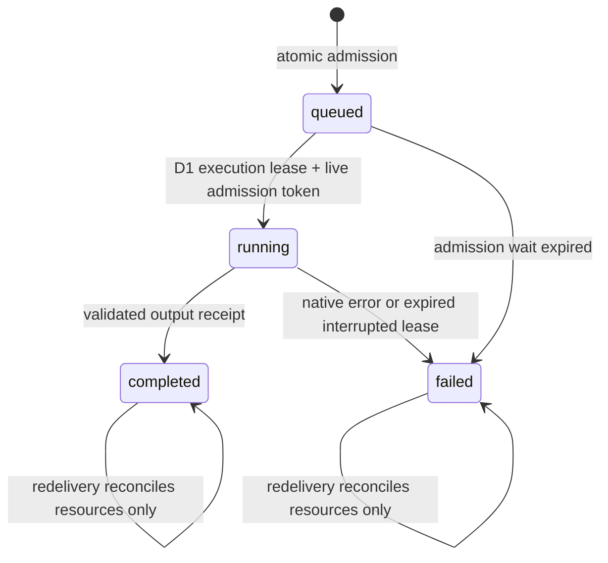

# 06 — Studio processing, planning and jobs

Pinned source: `1f9415ee19e1e6ed175df6ef8aac8edc7182c9e9`. The current Studio is a deterministic, editable media assembler. It stores/probes originals, accepts human metadata and copy, proposes bounded recipes, renders through native FFmpeg, records explicit revision approval and exports files. It does not infer scene meaning, recognize speech, write undeveloped commercial copy, synthesize voice or post to social networks. Sources: `src/core/studio.ts:L6-L74`, `src/core/studio-planner.ts:L122-L209`, `server/studio-render.ts:L208-L281`.

## Functional nodes

```mermaid
flowchart LR
  U[Resumable upload] --> O[Private immutable original]
  O --> PR[Trusted probe and SHA]
  PR --> MA[Human material card]
  MA --> PL[Optional deterministic planner]
  MA --> MR[Manual recipe]
  PL --> RV[Editable recipe plus trusted provenance]
  MR --> RV
  RV --> AD[Atomic admission]
  AD --> Q[Durable queue]
  Q --> LE[Execution lease]
  LE --> CO[Fresh managed container]
  CO --> FF[Native FFmpeg montage]
  FF --> AR[Private MP4 and cover]
  AR --> RE[Exact-revision review]
  RE --> AP[Explicit approval]
  AP --> EX[Authenticated export]
  O -. optional technical range scan .-> AN[Measurements and thumbnails]
  AN -. human selects locks .-> PL
```

| Node | Input/output | Implementation |
|---|---|---|
| Upload | Declared file →recoverable offsets/session →stored original. | `server/studio-hosted.ts:L331-L441`. |
| Trusted probe | Actual file bytes →SHA, kind, MIME, duration/dimensions/audio-track/compatibility. | `processor/runner.mjs:L27-L40`, `server/studio-render.ts:L101-L148`. |
| Material card | Human categories/roles/review/rights/speech/useful range with asset or text. | `src/core/studio.ts:L172-L219`. |
| Planner | Human constraints + current facts + bounded usage history →up to three recipes, reasons, warnings, exclusions and fingerprint. | `src/core/studio-planner.ts:L122-L209`. |
| Admission | Current recipe + Settings/usage →queued job, internal debit, storage reserve, compute lease. | `server/studio-hosted.ts:L219-L252`, `server/studio-hosted.ts:L460-L487`. |
| Queue | Durable pending IDs/recovery counts/alarms →D1 job executor. | `server/studio-processor.ts:L31-L73`. |
| Native worker | Server-selected inputs/recipe →streamed private outputs; bounded scratch destroyed afterward. | `server/studio-processor.ts:L75-L162`, `server/studio-processor.ts:L216-L281`. |
| Review/export | Exact completed job/recipe, current permissions and explicit confirmation →approval/download. | `server/studio-hosted.ts:L639-L671`, `src/core/studio.ts:L335-L344`. |
| Analysis | Bounded compatible original range →technical intervals/JPEGs; hosted route remains gated. | `server/studio-analysis.ts:L43-L132`, `src/core/studio-analysis.ts:L7-L10`. |

## Originals, compatibility and resumability

Hosted capture admits one recoverable upload before R2 work begins. It reserves declared bytes, lazily creates multipart state and commits each completed offset. Chunks are at most 8 MiB and at least 5 MiB unless final; a chunk has a 30-second read deadline. The full original is at most 250 MiB. A client resumes by reading the stored session, then sending precisely its current offset; conflicting/in-flight offsets are 409. Cancellation confirms deletion/abort before releasing reservation; service failure leaves the session recoverable. Source: `server/studio-hosted.ts:L331-L392`, `server/studio-hosted.ts:L596-L623`.

Completion confirms actual object size, probes through the trusted processor and verifies SHA format. A successful probe is cached before library CAS so a lost response or later metadata conflict does not require another successful probe debit. Duplicate identity uses actual SHA plus byte size, not caller filename; the new upload references the existing asset. Duplicate object deletion occurs after metadata commit, and failed deletion keeps its bytes in accounting. Sources: `server/studio-hosted.ts:L394-L441`.

Technical probing uses bounded native FFprobe, a local-file protocol allowlist and supported demuxer list. It accounts for rotation in reported display dimensions, identifies WebM through bounded EBML bytes and inspects audio presence independently of human speech labels. HDR transfers `smpte2084/arib-std-b67` and visual inputs above 40 million pixels are marked unsupported for this SDR renderer. The runner can preserve an unprocessable original as unsupported with its actual hash rather than pretending compatibility. A file extension or supplied MIME is only a hint. Sources: `server/studio-render.ts:L40-L42`, `server/studio-render.ts:L101-L148`, `processor/runner.mjs:L27-L40`.

## Rule-based planning and abstention

The planner accepts at most 50 candidate materials, three locked selections and three analysis references; duration is 5–60 seconds. Every material must be ready, associated with the campaign product or explicitly allowed as shared, and owned/licensed. Licensed or restricted-use material needs explicit per-piece review. Ideas require manual development. A selected ready-text source must be used literally as the body. Sources: `src/core/studio-planner.ts:L7-L24`, `src/core/studio-planner.ts:L42-L84`, `src/core/studio-planner.ts:L122-L147`.

Human locks keep their order and exact ranges. The algorithm never silently trims overfull locks. Only images or human-classified B-roll videos fill remaining background slots automatically. Retained speech needs a human-fixed range; unknown/present speech is not automatically cut while preserving source sound. Muted background requires explicit consent. Narration replaces source sound and must cover the entire piece. A narrated demo needs narration or confirmed human speech with an actual audio track. Sources: `src/core/studio-planner.ts:L140-L173`, `src/core/studio-planner.ts:L229-L245`.

Usage compares original SHA and millisecond intervals across current variants and historical completed jobs, so a duplicate material entry cannot bypass reuse checks. Unless explicitly allowed, occupied ranges are subtracted; photos have no independent timeline and are not split into artificial unused windows. Automatic background windows need at least two seconds. Up to three windows per original enter ranked candidates; rank prefers background role, reviewed useful range, sufficient capacity and 9:16 shape, then stable IDs/start time. Combinations fill at most three total segments and produce at most three alternatives. Insufficient valid footage causes abstention with a domain error. Sources: `src/core/studio-planner.ts:L86-L119`, `src/core/studio-planner.ts:L149-L190`.

Copy preflight enforces literal developed body, template length limits, conservative 15 characters/second and minimum two-second nonempty slots, plus an approximate readable line count. This is a conservative feasibility check, not a replacement for actual visual review. Text template allows body up to 20,000 characters and hook/CTA 240; multimedia body up to 900 and hook/CTA 160. Sources: `src/core/studio-planner.ts:L59-L74`, `src/core/studio.ts:L292-L295`.

The fingerprint hashes canonical planner version, library revision, campaign facts, input, material/asset facts and sorted trusted history. On save, the server recomputes the proposal; caller-supplied recipe/provenance cannot substitute for the trusted result. Planned variants retain editable provenance, and all effect boundaries recheck campaign, exact source facts, permissions, copy, range/reuse/consent and optional analysis consistency. Human classification changes can invalidate a planned recipe even if `contentVersion` is unchanged. The hosted history reader stops at 5,000 completed clip rows; this ceiling affects planning/planned validation and does not introduce that query into ordinary unplanned manual recipes. Sources: `src/core/studio-planner.ts:L191-L246`, `src/core/studio.ts:L379-L393`, `server/studio-hosted.ts:L147-L171`, `server/studio-hosted.ts:L585-L594`.

## Admission, reservations and internal credit

| Bound | Source behavior |
|---|---|
| Settings defaults | Monthly planning allocation 2,000 cents; processing 1,000; future AI zero; storage 2 GiB; new-piece duration 20 seconds. |
| Settings maxima | Monthly/individual allocations ≤2,000 cents; processing+AI ≤monthly total; storage ≤2 GiB; duration integer 5–60. |
| Hosted probe | Five internal cents when fresh trusted work is admitted; successful cached probe reused. |
| Hosted render | Ten internal cents per newly admitted render; reserve 270 MiB for MP4/cover. |
| Prepared hosted analysis | Five internal cents and at most 1 MiB thumbnails; admission currently refused because hosted pin is null. |
| Local analysis | Zero internal charge; local compute/tool/version prerequisites remain real. |
| Single compute admission | Singleton token with ten-minute expiry; current monthly processing budget and current storage limit read inside admission SQL. |
| Metadata | 8 MiB Studio+analysis/reserved metadata; 1,500 KiB hosted entity/job row; ≤900 statements per Studio mutation; ≤1,000 analyses. |
| Queue | ≤50 distinct pending IDs in the durable processor; deduplicated enqueue. |
| Native operation | 240-second aggregate wall deadline includes container start, package installation, staging, processing and output storage. |

Sources: `src/core/settings.ts:L3-L38`, `server/studio-hosted.ts:L27-L31`, `server/studio-hosted.ts:L99-L129`, `server/studio-hosted.ts:L219-L252`, `server/studio-hosted.ts:L276-L293`, `server/studio-hosted.ts:L406-L413`, `server/studio-hosted.ts:L479-L487`, `server/studio-local.ts:L295-L311`, `server/studio-processor.ts:L10-L13`, `server/studio-processor.ts:L31-L44`.

These cents are an internal admission ledger, not provider metering or an account invoice hard cap. Changing the future-AI allocation does not connect a provider, enable inference or spend it. Failed admitted processing remains charged; no automatic refund or alternate paid provider follows. Lowering limits preserves data/usage; Settings refuses edits while upload or queued/running compute work is active. Sources: `src/core/settings.ts:L16-L38`, `server/studio-hosted.ts:L198-L217`, `server/studio-hosted.ts:L219-L267`, `server/studio-hosted.ts:L530-L538`.

## Durable jobs, leases and interruption

Render submission first checks recipe revision and recomputes the current render spec. If an existing nonfailed job has the same spec and source snapshots, it returns that job; a queued job can be explicitly re-enqueued. A completed job is reused unless `regenerate:true`. Admission persists debit, reservation and job before enqueue, so a lost enqueue acknowledgement leaves a discoverable recoverable job without a second debit. Source: `server/studio-hosted.ts:L460-L487`.

The durable object persists pending IDs and sets an alarm. It retains an in-flight ID across eviction and establishes a 610-second watchdog. Execution claims the D1 queued job only while its ten-minute compute token remains live. Duplicate delivery during a running live lease returns without rendering. A running expired lease becomes failed; a queued expired admission becomes failed. Neither path automatically repeats native paid work. Completed/failed deliveries may reconcile a leftover reservation once. Sources: `server/studio-processor.ts:L31-L73`, `server/studio-hosted.ts:L489-L538`.

Infrastructure exceptions that escape execution are retained with recovery counts. The processor allows two infrastructure attempts, then parks that pending ID until another explicit owner request re-enqueues it. This queue-level watchdog is distinct from a fresh paid native render; D1 terminal/interrupted state still prevents repeated render execution. Source: `server/studio-processor.ts:L41-L70`.

Resource release uses the job's remaining reserved-byte field, sets it to zero in a batch and only clears a singleton compute token owned by that job. Thus an old job finishing after its global lease expires cannot clear a newer job's token. Actual partial outputs count as stored even on failure. No completed artifact becomes exportable merely because bytes were written; the job receipt must complete and pass review/approval. Sources: `server/studio-hosted.ts:L258-L267`, `server/studio-hosted.ts:L519-L538`, `server/studio-hosted.ts:L644-L671`.

## Native processor and deterministic render

The processor accepts fixed object-key patterns, a bounded job ID, at most four distinct original inputs (three visuals plus narration), and outputs fixed to that job's MP4/cover names. It exposes bound RPC methods, not a public execution endpoint or container port. Operations serialize through a promise queue. Each operation destroys a previous running container, starts a managed Debian image on `standard-2` with internet enabled, sets inactivity timeout, installs FFmpeg/fonts with `apt-get`, stages reviewed renderer/analyzer/runner modules and the application font, then destroys the scratch container in `finally`. Source: `server/studio-processor.ts:L19-L29`, `server/studio-processor.ts:L75-L162`, `server/studio-processor.ts:L216-L229`.

The image tag and package install commands do not pin an immutable FFmpeg binary version. Every fresh operation depends on package network/bootstrap availability. This is a code-observed operational property; the dossier does not claim a reproducible hosted native toolchain or infer successful hosted analysis from renderer capability. The hosted analyzer pin remains null. Sources: `server/studio-processor.ts:L137-L139`, `server/studio-processor.ts:L216-L225`, `src/core/studio-analysis.ts:L7-L10`.

Media streams from R2 to server-selected scratch paths; originals and outputs are not buffered as one large Worker byte array. Runner JSON input is ≤64 KiB. Captured metadata output is 64 KiB (analysis 80 KiB), diagnostic input ≤256 KiB, retained tail 8 KiB; logs expose fixed classifications/stage/code rather than raw stderr, caller text, filenames, keys or command arguments. Font download is ≤2 MiB, MIME-checked and must begin with the expected SFNT bytes. R2 output uses a fixed-length stream and conditional create so an existing job artifact cannot be overwritten. Sources: `server/studio-processor.ts:L164-L209`, `server/studio-processor.ts:L232-L281`, `processor/runner.mjs:L65-L104`.

Native tools run fixed argv with `shell:false`, absolute tool paths, local-file protocol allowlists, bounded probe and stdout/stderr, and timeouts. These controls are not a general OS sandbox. Renderer outputs use server-owned directories and nonoverwriting publication; no caller executable/filter string/URL is accepted. Sources: `server/studio-render.ts:L66-L104`, `server/studio-render.ts:L150-L161`, `processor/runner.mjs:L22-L62`.

Rendering produces portrait 1080×1920, 30 fps, square pixels and YUV420p H.264 with veryfast/CRF23 and faststart. Contain preserves aspect ratio with charcoal padding; cover crops by normalized global focus. Visuals concatenate in declared order. Narration replaces source audio; otherwise keep mode normalizes available audio to stereo/48 kHz with silence padding for silent segments; mute yields no audio. Hook/body/CTA occupy fixed template time slots with readable text wrapping, decreasing font size no lower than 36, dark panel and literal textfile input with expansion disabled. The output metadata is stripped. Sources: `server/studio-render.ts:L164-L200`, `server/studio-render.ts:L208-L281`.

| Template | Panel position/size in 1080×1920 | Hook ends / CTA starts |
|---|---|---|
| overlay | x60 y1180, 960×640 | 22% / 78% |
| demo | x60 y1370, 960×470 | 18% / 82% |
| tips | x60 y980, 960×840 | 14% / 88% |
| motivation | x60 y650, 960×680 | 25% / 85% |
| text | x60 y420, 960×1080 (renderer preset exists; ordinary Studio text exports TXT) | 20% / 85% |

Source: `server/studio-render.ts:L40-L50`. These presets position supplied copy; they do not invent bullet points or narrative.

Native FFmpeg gets 120 seconds for video and 15 for the first-frame PNG cover. It probes output dimensions/duration, then publishes completed files through exclusive hard links. Hosted execution independently checks stored video ≤250 MiB, cover ≤20 MiB, total ≤270 MiB, exact portrait dimensions and duration within 0.2 seconds. Failed output checks retain originals and immutable job receipt, record a safe error and require an explicit new render. Sources: `server/studio-render.ts:L269-L281`, `server/studio-hosted.ts:L519-L538`.

## Technical analysis is measured navigation, separately gated

The analysis contract has profile `technical-v1`, a millisecond-precision positive range ≤120 seconds, ≤100 intervals, ≤6 JPEG thumbnails with ≤1 MiB total, ≤64 KiB JSON and ≤20 bounded warning strings. Allowed markers are scene points, low volume, black and freeze intervals. `complete/partial/unavailable` describes measured coverage, not creative meaning; unavailable results may contain no measurements. Source: `src/core/studio-analysis.ts:L1-L72`.

Analysis checks the exact FFmpeg version string and presence of `silencedetect`, `scdet`, `blackdetect`, `freezedetect`. Visual measurement scales to 320 pixels/five fps; audio measurement detects low-volume intervals; thumbnails sample evenly. Work has an aggregate 120-second deadline, partial failures become warnings, marker overflow becomes partial, and thumbnails validate JPEG magic/nonoverwrite/size. Human speech, categories, rights and cut decisions remain unchanged. Sources: `server/studio-analysis.ts:L17-L39`, `server/studio-analysis.ts:L43-L132`.

At this pinned source, local admission expects one exact tested tool version string. Hosted `ANALYSIS_HOSTED_TOOL_VERSION` is null, so a hosted request fails before budget reservation or enqueue. Code for hosted cache/admission/execution/schema is present but that does not mean the feature is enabled. Analysis references are valid only for completed compatible-profile/tool results matching selected original SHA and covering a human locked range; they do not silently generate cuts. Sources: `src/core/studio-analysis.ts:L7-L10`, `server/studio-local.ts:L295-L311`, `server/studio-hosted.ts:L162-L171`, `server/studio-hosted.ts:L276-L326`.

## Review, provenance and exports

The recipe editor and completed job receipt are distinct. A meaningful recipe change increments recipe revision and loses approval. Source snapshots are intentionally retained until explicitly refreshed; current source rights and relevant historical rights still govern export. Planned variants require current full facts at each effect boundary. The owner must review a completed current-revision preview and explicitly confirm approval; successful rendering or downloading a preview does not approve it. Text approval records a completed text receipt without native media compute. Sources: `src/core/studio.ts:L237-L344`, `src/core/studio.ts:L395-L407`, `server/studio-hosted.ts:L644-L661`.

Export rechecks rights, current approval revision, planner provenance/reuse/analysis and matching completed job, then streams MP4 or literal hook/body/CTA TXT. It does not attach a social account, publish content, activate an ad or confirm delivery in the legacy post queue. Sources: `server/studio-hosted.ts:L663-L671`, `src/core/studio.ts:L6-L7`.

## Available test coverage versus present execution

The source includes regression tests for SQL/CAS rollback, owner/nonowner access, chunk conflicts/resume/deduplication, atomic admission and reservation release, stale fingerprints/classification/reuse, exact-recipe approval and export, interrupted leases, processor streaming/deadlines/log redaction, and bounded real-tool synthetic rendering/analysis. Locators: `tests/studio-hosted.test.ts:L87-L396`, `tests/studio-processor.test.ts:L27-L235`, `tests/studio-planner.test.ts:L27-L213`, `tests/studio-render.test.ts:L35-L123`, `tests/studio-analysis.test.ts:L27-L89`, `tests/studio-api.test.ts:L29-L314`.

Those tests were inspected as coverage sources; this documentation task does not rerun them or turn historical synthetic tests into fresh production evidence. Physical-phone capture/microphone behavior, creative quality, real invoice limits and recovery rehearsal require their own current execution evidence. Architecture and test existence alone cannot settle them.

See [request/auth/storage flow](code-flow/01-request-auth-and-storage.md) and [media flow](code-flow/03-media-planning-render-export.md) for node-by-node traces.
