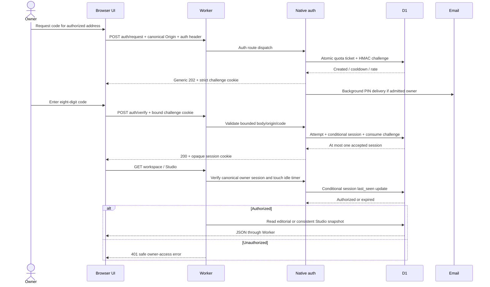

# Flow 01 — Request, auth and storage

Source snapshot: `1f9415ee19e1e6ed175df6ef8aac8edc7182c9e9`. This is a manually traced functional graph, not a dynamically recorded call graph. API details: [05](../05-backend-api-and-access.md); data/transaction details: [02](../02-data-model-and-transactions.md).

| Node | Function and success | Failure/preservation | Source |
|---|---|---|---|
| `R01` Static/API boundary | Non-API request uses asset binding; `/api/` reaches native adapter. | Static delivery does not grant a session. | `server/worker.ts:L106-L113` |
| `R02` Auth route gate | Recognized POST auth routes; exact canonical URL/Origin, custom header, valid bindings. | 404/405/403/503 before privileged action. | `server/native-auth.js:L128-L137` |
| `R03` Body boundary | ≤512 byte object with three-second deadline. | 400/408/413; reader cancelled. | `server/native-auth.js:L86-L116` |
| `R04` Challenge admission | Purpose-HMAC keys, atomic quota guard ticket, five-minute challenge; unknown addresses follow generic response. | Quota 429 or cooldown; no unauthorized-address mail. | `server/native-auth.js:L156-L187`, `server/native-auth-store.js:L16-L65` |
| `R05` Mail | Background fixed PIN message to configured owner. | Fixed diagnostic and revoke challenge on delivery failure. | `server/native-auth.js:L173-L183` |
| `R06` Verify | Browser challenge token + PIN →single-use consume and six-hour opaque session. | Invalid code 401; fifth attempt may work; expired/consumed/wrong browser cannot. | `server/native-auth.js:L189-L202`, `server/native-auth-store.js:L112-L127` |
| `R07` Owner session | Canonical origin, strict unique cookie, owner HMAC, idle <30m and absolute <6h. | Returns false; native data API responds 401. | `server/native-auth.js:L118-L125`, `server/native-auth-store.js:L130-L134`, `server/worker.ts:L118-L120` |
| `R08` Session status | GET returns hosted/config/auth/code-flow metadata. | User address omitted unless authorized. | `server/worker.ts:L119-L119` |
| `R09` Editorial read/command | Read workspace or validate command/revision →domain transform →repository save. | Stale revision 409; domain errors preserved; generic 503 for unknown errors. | `server/api.ts:L56-L96` |
| `R10` Editorial CAS | Revision-specific D1 update/initial insert with ≤1MiB doc and Studio product-preservation SQL. | Exactly one row must change; otherwise 409. | `server/d1.ts:L7-L23` |
| `R11` Studio dispatch | Both media and processor bindings required; current workspace passed into adapter. | Missing binding →503. | `server/worker.ts:L121-L127` |
| `R12` Studio origin gate | Canonical URL, no foreign/cross-site request, mutation Origin required. | 403 or 405. | `server/studio-hosted.ts:L540-L545` |
| `R13` Studio snapshot/CAS | Consistent batched read; token-guarded entity mutations and optional current editorial revision. | 409 on changed state; no caller whole-state replacement route. | `server/studio-hosted.ts:L88-L132` |
| `R14` Private bytes | Asset/job route resolves server storage key then range-streams R2. | 404 absent, 409 incomplete job, 416 invalid range; no raw bucket URL. | `server/studio-hosted.ts:L443-L458`, `server/studio-hosted.ts:L626-L637` |
| `R15` Logout/purge | Revoke presented session/challenge; clear cookies. Scheduled auth cleanup removes expired rows. | No business-content deletion. | `server/native-auth.js:L204-L216`, `server/native-auth-store.js:L8-L13`, `server/worker.ts:L107-L107` |

## Editorial mutation trace

1. Browser sends `{revision,type,data}`; native owner check precedes access.
2. `editorialApi` validates request JSON, optional supplied Origin and exact known revision.
3. Shared domain clones the last workspace, validates one command, enforces relationships/state and increments revision.
4. D1 serializes JSON and atomically writes only if expected revision still matches. With Studio enabled, removing any product needed by Studio fails the same SQL guard.
5. Success returns next workspace. Conflict preserves previous committed state and returns 409; client must retain/compare its draft and reload explicitly.

Source chain: `server/worker.ts:L115-L128` →`server/api.ts:L66-L83` →`src/core/domain.ts:L164-L455` →`server/d1.ts:L11-L23`.

## Studio mutation trace

1. Owner gate and Studio origin/method guards run.
2. Read consistent Studio revision/entities and current editorial workspace.
3. Compare `expectedRevision`; validate command/dependencies. For planned save, recompute trusted proposal and compare fingerprint.
4. Shared Studio domain applies one command. It cannot accept browser asset metadata registration or browser-trusted approval.
5. `saveState` validates metadata bounds, obtains a fresh write token through revision CAS plus editorial revision guard, and token-guards all entity changes in one batch.
6. Return `{state}`; conflicts or safe error codes preserve committed state. Native processing and R2 operations have separate admission/job boundaries.

Source chain: `server/studio-hosted.ts:L540-L545` →`server/studio-hosted.ts:L573-L594` →`src/core/studio.ts:L347-L415` →`server/studio-hosted.ts:L99-L132`.

## Alternative/local scope

The local Vite path uses loopback Host/socket/origin validation and serialized requests instead of owner mail. `/api/session` reports local authentication; JSON editorial state and SQLite Studio are separate persistence adapters. It does not bind a LAN listener. Sources: `vite.config.ts:L49-L114`, `vite.config.ts:L120-L142`.

The exported Supabase password route is a separate prepared alternative; it is not in the default native request sequence and failure does not select it. Sources: `server/worker.ts:L16-L105`, `server/worker.ts:L106-L128`.
