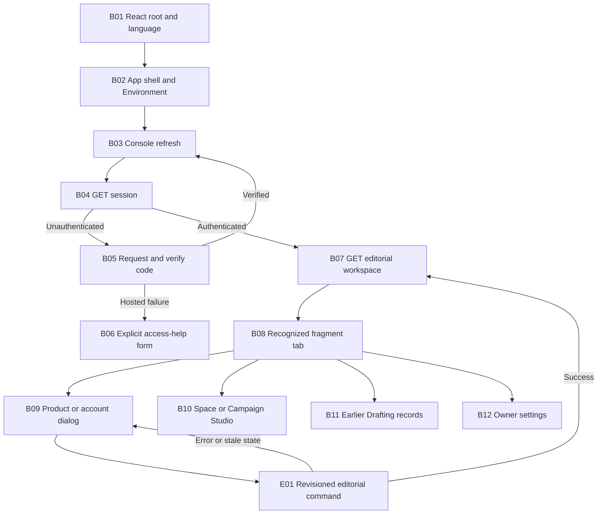
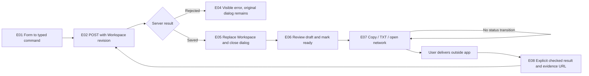
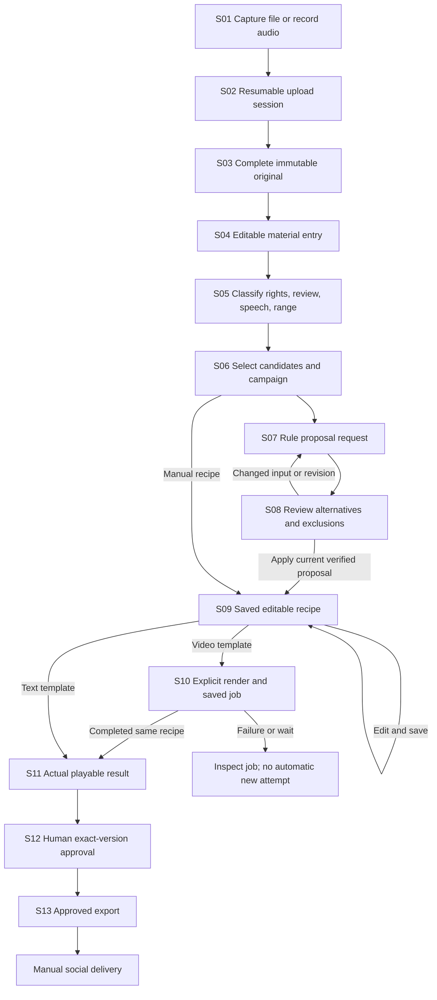
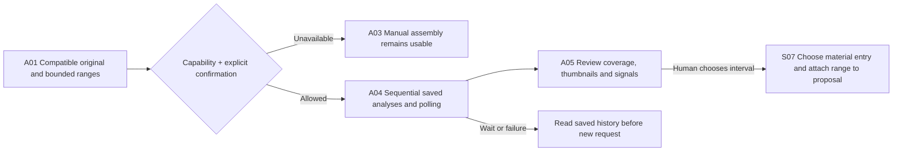

# Browser, editorial and Studio interaction nodes

Snapshot: source commit `1f9415ee19e1e6ed175df6ef8aac8edc7182c9e9`, 2026-10-24. These are manually derived functional nodes, not an instrumented runtime trace or an exhaustive generated call graph. Private references identify the responsible source ranges without publishing source bodies, identities or records. Backend/storage implementations are covered in their separate chapters.

## B01–B12: startup, navigation and authenticated workspace

| Node | Responsibility and key input/output | Failure / revision behavior | Private source |
|---|---|---|---|
| B01 | Mount StrictMode, LanguageProvider and App; load global/console/release CSS | Language defaults to English when optional storage fails | `src/main.tsx:L1-L9`, `src/i18n.tsx:L336-L345` |
| B02 | Own companions, pause, cache, scene selection/playback and logo/signature | Access loss revokes optional decorative cache; disabling companions unmounts canvas | `src/App.tsx:L12-L78` |
| B03 | Refetch session, load workspace only for an authenticated result | Catches load errors; Reload offers another explicit read | `src/console/Console.tsx:L145-L159` |
| B04 | Interpret local/hosted, authenticated/configured and selected auth-flow response | Unconfigured/loading/login are separate display branches | `src/console/Console.tsx:L118-L124`, `src/console/Console.tsx:L299-L344` |
| B05 | Request a temporary code, then verify eight digits; refresh after success | Failed hosted login reveals help; requesting a different code is explicit | `src/console/Console.tsx:L185-L209`, `src/console/Console.tsx:L319-L342` |
| B06 | Collect an email and language only after the user opens/submits help | Own busy/error/status, generic authorized-recipient result; no send on opening | `src/console/Console.tsx:L210-L224`, `src/console/Console.tsx:L345-L366` |
| B07 | Hold the editorial Workspace for products/accounts/earlier records | Does not become the Studio state store | `src/console/Console.tsx:L115-L117`, `src/core/domain.ts:L60-L68` |
| B08 | Accept seven fragments and synchronize tab; clear selected filters on nav | Recording/pending recording holds tab/hash; unknown fragment becomes Overview | `src/console/Console.tsx:L36-L56`, `src/console/Console.tsx:L136-L144`, `src/console/Console.tsx:L414-L429` |
| B09 | Native modal for product/account, existing source or post editing | Dialog stays open on failed save; preserves previous focus; cancel guarded while busy | `src/console/Console.tsx:L880-L957` |
| B10 | Lazy Studio instance with Space/Campaigns view prop and shared product references | Own refresh/errors/jobs; separate expected Studio revision | `src/console/Console.tsx:L667-L668`, `src/console/Studio.tsx:L57-L117` |
| B11 | Filter/review/copy/export and explicit delivery confirmation for earlier posts | No automatic delivery; scheduled/published records cannot ordinary-edit | `src/console/Console.tsx:L377-L406`, `src/console/Console.tsx:L780-L855` |
| B12 | Shared saved settings plus the same App-owned Environment controls | Own settings revision/draft; inactive AI remains inactive | `src/console/Console.tsx:L668-L668`, `src/console/Settings.tsx:L15-L94` |

Current navigation has New product and New account buttons. Legacy source/campaign editor variants remain implemented, but a diagram node for an editor is not evidence that a current primary button opens every variant. Existing earlier sources/campaigns are retained in dedicated sections. Sources: `src/console/Console.tsx:L435-L447`, `src/console/Console.tsx:L669-L779`.

## E01–E08: editorial command and manual result

| Node | Concrete rule | Private source |
|---|---|---|
| E01 | FormData plus arrays and checked booleans chooses `product.save`, `account.save`, `source.save`, `campaign.create`, `post.save` or `post.confirm` | `src/console/Console.tsx:L935-L957` |
| E02 | Shared client sends JSON command with known revision; same-origin credentials/no-store | `src/core/client.ts:L1-L23` |
| E03–E05 | Console serializes its save actions, updates state only after success and reports failure without closing the dialog | `src/console/Console.tsx:L169-L184`, `src/console/Console.tsx:L957-L957` |
| E06 | Ready requires copy and format review; Instagram/TikTok text-only records stay draft; proposed times are absolute and unique per account | `src/core/domain.ts:L369-L412` |
| E07 | Clipboard/download/open-network have no domain command and do not mark delivery | `src/console/Console.tsx:L234-L240`, `src/console/Console.tsx:L825-L843`, `src/core/client.ts:L24-L33` |
| E08 | Ready organic post, scheduled/published choice, safe evidence URL and explicit true confirmation | `src/core/domain.ts:L415-L434`, `src/console/Console.tsx:L1345-L1376` |

Deletion is a separate command path: posts must be retired/deleted before a campaign, campaigns must release sources before source removal, and accounts/products retain dependency checks. Copying/exporting or confirming delivery never automatically purges anything. Source bodies render as ordinary escaped text; Markdown is not executed. Sources: `src/core/domain.ts:L190-L202`, `src/core/domain.ts:L248-L293`, `src/core/domain.ts:L359-L367`, `src/core/domain.ts:L436-L442`, `src/console/Console.tsx:L693-L695`.

## S01–S13: capture, plan, manual edit and exact result

| Node | Inputs / output / owned rule | Failure or change path | Private source |
|---|---|---|---|
| S01 | Selected file or microphone chunks; optional product/category | Retain failed-upload recording for retry/download; block navigation while needed | `src/console/Studio.tsx:L83-L100`, `src/console/Studio.tsx:L148-L167`, `src/console/Studio.tsx:L229-L234` |
| S02 | File metadata → remembered upload ID → authoritative offset PUT chunks | Resume by reselecting same file; explicit pending-upload cancellation | `src/console/Studio.tsx:L120-L136`, `src/console/Studio.tsx:L235-L235` |
| S03 | Complete upload registers original asset | An original can survive an entry-write failure; Recover entry is offered | `src/console/Studio.tsx:L137-L146`, `src/console/Studio.tsx:L236-L236` |
| S04 | Entry references asset or independent text/idea | Unknown rights/speech and unreviewed state initially; duplicate original can have another entry | `src/console/Studio.tsx:L139-L144` |
| S05 | Manual multiple tags/products/roles, rights/restrictions, useful interval and review | Content version changes are distinct from immutable original; referenced deletion refused | `src/console/Studio.tsx:L168-L177`, `src/console/Studio.tsx:L238-L270` |
| S06 | Up to 50 selected entries; chosen product campaign | Shared eligibility requires explicit permission in planner | `src/console/Studio.tsx:L263-L289`, `src/console/StudioPlanner.tsx:L62-L75` |
| S07 | Snapshot request + current library; deterministic proposal endpoint | No valid proposal shows reasons/exclusions and retains fields; no compute reservation | `src/console/StudioPlanner.tsx:L77-L85`, `src/console/Studio.tsx:L289-L289` |
| S08 | Main and alternatives; fingerprint; proposal-bound Studio revision | Input/revision changes disable Apply; replacing unsaved recipe requires acknowledgment | `src/console/StudioPlanner.tsx:L54-L60`, `src/console/StudioPlanner.tsx:L87-L94`, `src/console/StudioPlanner.tsx:L142-L154` |
| S09 | Server command saves ordinary editable recipe, source snapshots and provenance | Session draft only until successful save; recipe changes require new result/review | `src/console/Studio.tsx:L189-L213`, `src/console/Studio.tsx:L290-L322` |
| S10 | Exact recipe render request, explicit regeneration choice; queued/running job | Reuse completed exact result; explicit request for another render; inspect failures | `src/console/Studio.tsx:L101-L106`, `src/console/Studio.tsx:L323-L328` |
| S11 | Completed video/cover or saved text preview | Unsaved edit blocks further action; only matching recipe job is current | `src/console/Studio.tsx:L180-L183`, `src/console/Studio.tsx:L319-L329` |
| S12 | Required rights/review checkbox, recipe revision and job ID | Domain requires trusted completed exact result for multimedia and adequate current rights | `src/console/Studio.tsx:L330-L333`, `src/core/studio.ts:L280-L296`, `src/core/studio.ts:L395-L408` |
| S13 | Approved current recipe and result download | Backend export assertion can reject old approval; no publishing/status inference | `src/console/Studio.tsx:L334-L337`, `src/core/studio.ts:L335-L344` |

The original, material entry, source snapshot, recipe and render job have different identities. A change to one is not permission to mutate the others. A detached reviewer should specify which identity and revision a new operation consumes, especially for duplicate originals, repeated source intervals and historical completed renders.

## A01–A05: optional analysis remains a human aid

The UI accepts at most three intervals, each at most 120 seconds, runs them sequentially and displays maximum internal reservation before submission. Results carry partial/unavailable coverage information. A chosen interval is explicitly mapped to a material entry for that asset and attached as a human locked range. No output automatically changes review state, B-roll category, speech presence or text. Sources: `src/console/StudioAnalysis.tsx:L25-L72`, `src/console/StudioAnalysis.tsx:L74-L106`, `src/console/StudioPlanner.tsx:L113-L119`.

## R01–R04: reusable concurrency and recovery nodes

| Node | Current implementation | Review constraint |
|---|---|---|
| R01 Browser draft | Named fields/session storage for Studio forms; controlled request/fields for Planner/Settings | Recover fields, not an assumed successful server write |
| R02 CAS submit | Editorial revision, Studio expected revision or Settings expected revision at the appropriate boundary | Never reuse a revision from a different store |
| R03 Reconciliation | Compare current saved data, re-propose when source/input changed, or explicitly confirm replacing current Settings/recipe | Do not silently rebase stale intent |
| R04 Saved uncertain job | Inspect queue/job/analysis history, refresh/resume explicitly | An HTTP error/timeout does not prove no external work was accepted |

Sources: `src/console/Studio.tsx:L17-L47`, `src/console/Studio.tsx:L113-L117`, `src/console/Studio.tsx:L204-L213`, `src/console/StudioPlanner.tsx:L54-L94`, `src/console/Settings.tsx:L24-L64`, `src/console/StudioAnalysis.tsx:L58-L71`.

## T01–T04: local text simulation

The conditional node exists only in a DEV build and local session: select a product/campaign/draft and exact campaign sources → generate an explicitly marked simulated response → edit → prepare one save → ordinary editorial command with the original revision. The simulator rejects incompatible selections, changed snapshots, wrong request reuse, expiry, capacity overflow, malformed output and repeated save preparation. Unsaved results live for five minutes, with 16 retained requests maximum. Unmount aborts and clears. These are local simulator limits, not an OpenAI entitlement or provider retention policy. Sources: `src/console/Console.tsx:L32-L34`, `src/console/Console.tsx:L780-L784`, `src/console/TextSimulation.tsx:L14-L82`, `src/core/generation.ts:L5-L12`, `src/core/generation.ts:L97-L180`.

For user intent and record semantics, see [product workflows](../03-product-and-user-workflows.md). For state ownership, storage lifetime, styling and localization, see [frontend](../04-frontend-and-interaction.md).
