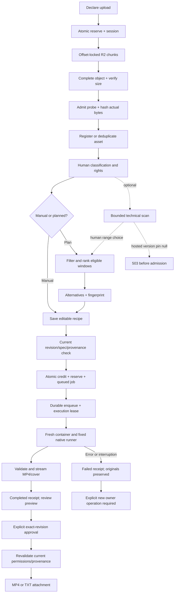

# Flow 03 — Media, planning, render and export

Source snapshot: `1f9415ee19e1e6ed175df6ef8aac8edc7182c9e9`. These nodes explain the current source flow. They do not certify a particular production record or new native execution. Full contracts: [05](../05-backend-api-and-access.md), [06](../06-studio-processing-and-jobs.md).

| Node | Functionality as implemented | Source |
|---|---|---|
| `M01` Declare | Name/MIME/positive byte size; ≤250 MiB; validated raster/video/audio hint. | `server/studio-hosted.ts:L331-L339` |
| `M02` Reserve | D1 singleton upload token and reserved bytes + recoverable session before any multipart operation. | `server/studio-hosted.ts:L340-L351` |
| `M03` Chunk | Exact committed `Upload-Offset`; ten-minute row lock; 5–8 MiB nonfinal parts; 30-second body limit; save offset after R2 part. | `server/studio-hosted.ts:L353-L392` |
| `M04` Complete | Idempotent completed response; require full offset; confirm R2 actual size. | `server/studio-hosted.ts:L394-L403` |
| `M05` Probe | Five internal cents on fresh admission; bound processor probe returns actual hash/metadata; successful probe cached across later CAS conflict. | `server/studio-hosted.ts:L404-L413`, `processor/runner.mjs:L27-L40` |
| `M06` Register | Dedupe SHA+size; otherwise immutable asset. Studio CAS finalizes upload and reservation/accounting; failed duplicate deletion stays counted. | `server/studio-hosted.ts:L415-L440`, `src/core/studio.ts:L147-L169` |
| `M07` Human facts | Material card sets products/categories/roles/review/rights/speech/useful range; editing source content versions independently. | `src/core/studio.ts:L172-L219` |
| `M08` Route | Manual variant or deterministic proposal; neither calls an AI provider. | `src/core/studio.ts:L237-L277`, `src/core/studio-planner.ts:L122-L209` |
| `M09` Plan | Ready/allowed materials; rights/license review; preserve locks; safe B-roll/photo windows; prevent unintended reuse; conservative copy preflight; ≤3 segments. | `src/core/studio-planner.ts:L61-L190` |
| `M10` Proposal | Up to three alternatives with reasons/warnings/exclusions and canonical SHA fingerprint. No state mutation/debit. | `src/core/studio-planner.ts:L191-L209`, `server/studio-hosted.ts:L553-L556` |
| `M11` Save | Current library revision; planned save recomputes fingerprint/alternative on server and stores trusted proof; manual edits preserve proof if present. | `server/studio-hosted.ts:L573-L594`, `src/core/studio.ts:L376-L393` |
| `M12` Effect preflight | Recipe revision; fresh planned source/history/analysis validation; literal copy, compatible clips, exact total duration, narration/demo checks. | `server/studio-hosted.ts:L460-L465`, `src/core/studio.ts:L298-L332` |
| `M13` Admit | Ten internal cents, 270 MiB reserve, live compute token, exact Studio revision and queued immutable receipt in one D1 batch. | `server/studio-hosted.ts:L219-L252`, `server/studio-hosted.ts:L479-L487` |
| `M14` Execute once | Durable ID queue/alarm; D1 queued→running only with live compute admission; duplicate/live lease no new render; expired lease fails. | `server/studio-processor.ts:L31-L73`, `server/studio-hosted.ts:L489-L518` |
| `M15` Native | Serialize operation; fresh internet-enabled managed container, apt/bootstrap/stage/font, server-selected inputs and fixed runner; 240s aggregate deadline and destroy. | `server/studio-processor.ts:L118-L162`, `server/studio-processor.ts:L216-L265` |
| `M16` Outputs | Native 1080×1920/H.264/30fps; post-probe; streamed conditional private R2 writes; independent receipt dimensions/duration/size check. | `server/studio-render.ts:L237-L281`, `server/studio-processor.ts:L269-L281`, `server/studio-hosted.ts:L519-L529` |
| `M17` Review | Completed job and immutable source/recipe receipt; authenticated preview bytes are available for review before approval. | `server/studio-hosted.ts:L632-L637` |
| `M18` Approve | `confirmed:true`, exact recipe revision, current rights, completed matching video job/artifact; TXT records completed text receipt. | `server/studio-hosted.ts:L644-L661`, `src/core/studio.ts:L395-L407` |
| `M19` Revalidate | Fresh planned facts/history/analysis; approved revision; current and relevant historical rights; exact approved job. | `server/studio-hosted.ts:L663-L670`, `src/core/studio.ts:L280-L344` |
| `M20` Export | Literal TXT or authenticated MP4 attachment; no social/ad action or legacy post confirmation. | `server/studio-hosted.ts:L667-L671`, `src/core/studio.ts:L6-L7` |
| `MF` Failure | Safe error and immutable receipt; account actual partial bytes; once-only reservation release; no automatic paid retry. | `server/studio-hosted.ts:L258-L267`, `server/studio-hosted.ts:L501-L538` |
| `MA/MG` Analysis | Technical intervals/JPEGs aid human locks. Hosted pin null →refuse before debit; local exact tool/version contract separate. | `src/core/studio-analysis.ts:L1-L10`, `server/studio-hosted.ts:L276-L293`, `server/studio-analysis.ts:L43-L132` |

## Scenario: stale draft after another tab saves

The browser submits an old `expectedRevision`; server returns 409 and does not overwrite the current library. A previously shown plan is also bound to current library/campaign/material/history facts. Saving its stale fingerprint returns `plan_conflict`; the owner can preserve the editable request and propose again. This is an expected concurrency path, not permission to force a write. Sources: `server/studio-hosted.ts:L328-L329`, `server/studio-hosted.ts:L573-L594`.

## Scenario: a lost render submission response

Admission has already committed job/debit/reservation before durable enqueue. A later exact-recipe request locates the nonfailed immutable job. If queued it re-enqueues the same ID; if completed it returns reusable preview unless explicit regeneration requested. D1 lease guards actual processing, and terminal job redelivery only reconciles leftover resources. Sources: `server/studio-hosted.ts:L466-L487`, `server/studio-hosted.ts:L489-L518`.

## Scenario: material is relabeled or its rights change

Rights/restrictions edits clear current approvals. A planned recipe additionally compares full material and asset facts before render, approve and export; a title/classification/review change can therefore require re-proposing even without a content-version increment. Manual recipes preserve selected snapshots until explicit refresh, but still check current rights and relevant historical selected rights. Historical job receipts remain unchanged. Sources: `src/core/studio.ts:L215-L217`, `src/core/studio.ts:L244-L289`, `src/core/studio-planner.ts:L213-L245`.

## Scenario: container or media processing stops

Native errors mark failed without deleting originals or overwriting the immutable receipt. A running lease that has expired becomes interrupted rather than rerendering automatically. Partial outputs remain counted but are not exportable. A new owner request must explicitly create/recover the appropriate operation; queue infrastructure watchdog attempts do not bypass D1 paid-work state. Sources: `server/studio-hosted.ts:L501-L538`, `server/studio-processor.ts:L41-L70`.

## Scenario: TXT only

Text variants skip native render. Shared copy/rights/explicit confirmation checks still apply; approval atomically records a completed text usage receipt; export returns literal hook, body and CTA separated by blank lines. A text approval is not an MP4 receipt or a social delivery record. Sources: `src/core/studio.ts:L298-L302`, `server/studio-hosted.ts:L651-L667`.
