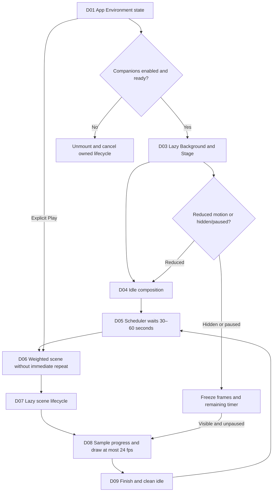
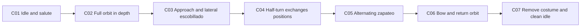
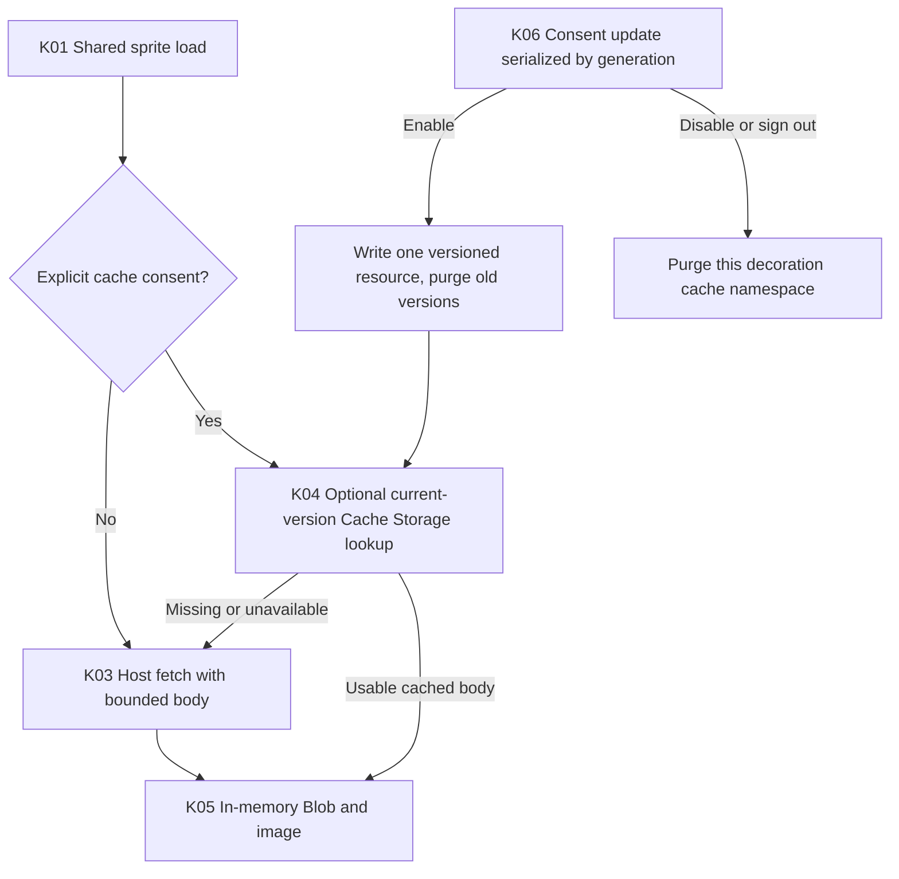
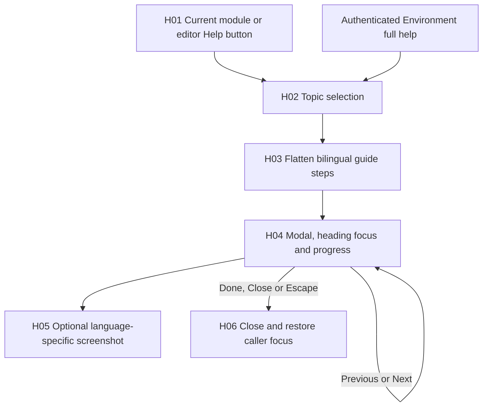

# Decoration, Environment, localization and Help nodes

Pinned source: `1f9415ee19e1e6ed175df6ef8aac8edc7182c9e9`, inspected 2026-10-24. Nodes below describe responsibilities and state transitions inferred from source. They are not a recording of a browser session, a new visual acceptance or proof of hosted asset delivery. The public dossier includes no source body or screenshot of owner content.

## D01–D10: noninteractive decorative lifecycle

| Node | Responsibility | Exact implementation / failure behavior | Private source |
|---|---|---|---|
| D01 | App owns enabled, paused, selected scene, preview nonce and playback state | Companions start enabled; pause/cache start false; initial selected replay is Kung fu | `src/App.tsx:L12-L24` |
| D02 | Delay canvas eligibility briefly, then lazy mount only when enabled | Unmount cleanup cancels scheduler/frame work; optional source load failure does not block app | `src/App.tsx:L25-L25`, `src/App.tsx:L55-L58`, `src/decoration/Background.tsx:L103-L118` |
| D03 | Create one Stage and media-query/listener lifecycle | Canvas is 384×216; wrapper is aria-hidden, inert and noninteractive | `src/decoration/Background.tsx:L20-L37`, `src/decoration/Background.tsx:L123-L124` |
| D04 | Render consistent front-facing resting characters | Finish clears episode state and paints idle; reduced motion keeps static presentation | `src/decoration/Background.tsx:L47-L55`, `src/decoration/Background.tsx:L84-L88`, `src/decoration/renderer.ts:L204-L207` |
| D05 | One timer owns either wait or active episode | Normal first/next wait is random 30–60 seconds; no hidden-time catch-up | `src/decoration/scheduler.ts:L20-L60` |
| D06 | Weighted choice excludes the previous scene and weight-zero entries | Selection fails if no eligible alternate exists; registry currently supplies eight scenes | `src/decoration/scheduler.ts:L13-L17`, `src/decoration/registry.ts:L8-L18` |
| D07 | Scene module supplies start/frame/finish, chosen once per episode | Token/disposed/reduced guards discard obsolete lazy loads; failure returns to idle | `src/decoration/Background.tsx:L56-L70`, `src/decoration/registry.ts:L4-L18` |
| D08 | Use performance-time progress, requestAnimationFrame and a 24 fps paint threshold | Paused/hidden/reduced state exits frame work; draw progress is bounded to 1 | `src/decoration/Background.tsx:L29-L45` |
| D09 | End active episode, clean canvas and schedule next rest period | Interrupted manual scene finishes the prior one; dispose cancels timeout ownership | `src/decoration/scheduler.ts:L48-L60`, `src/decoration/scenes.ts:L163-L172` |
| D10 | Preserve true pause and honor reduced motion | Pause stores remaining timer and shifts start time on resume; reduced mode finishes active scene | `src/decoration/Background.tsx:L72-L88`, `src/decoration/scheduler.ts:L54-L60` |

Manual replay is disabled when companions are off, paused or reduced-motion is active. A normal production build does not autoplay a demonstration immediately: the immediate opening scene is guarded by DEV. Environment's Play action can intentionally interrupt an episode; the scheduler cleans its previous lifecycle before taking ownership of the new one. Sources: `src/console/EnvironmentSettings.tsx:L15-L20`, `src/decoration/Background.tsx:L90-L102`, `src/decoration/scheduler.ts:L48-L53`.

### Scene registry and draw model

| Scene ID | Display name | Duration | Character relationship |
|---|---|---|---|
| `kungfu` | Kung fu | 14.5 s | Competitive; Codex payoff; selection weight 2 |
| `swords` | Espaditas | 12 s | Competitive; Codex payoff |
| `lasers` | Toy laser / Láser de juguete | 11 s | Competitive; Codex payoff |
| `stones` | Pebbles / Piedritas | 11 s | Competitive; Codex payoff |
| `tennis` | Tennis / Tenis | 12 s | Competitive; Codex payoff |
| `grill` | Barbecue / Parrilla | 13 s | Cooperative |
| `dance` | Dance / Baile | 12 s | Cooperative |
| `cueca` | Cueca | 20 s | Cooperative; no winner |

Source: `src/decoration/registry.ts:L8-L18`. Display labels are translated through the UI's language layer where mappings exist. The characters are decorative named Claude and Codex; no AI provider session is involved in playing them.

An ActorPose records position, facing, rotation, one of four real views, articulated pose, stride, expression, ground shadow/depth, scale and optional huaso costume. The four views are front, three-quarter, side and back; they have their own torso pixel geometry. Stage paints limbs, sprite-atlas torso or inline fallback, face and optional costume. It disables image smoothing and rounds pixel drawing. Depth ordering paints the farther partner first as paths cross. Sources: `src/decoration/renderer.ts:L1-L19`, `src/decoration/renderer.ts:L124-L164`, `src/decoration/scenes.ts:L163-L172`.

Episodes choose one of four bounded choreography variants once at start. `sampleScene` is a deterministic sampler for a given scene/progress/variant; variation includes travel direction, depth and choreography rather than a repeated rigid translation of one pose. Start/end normalize to the same idle composition. Source: `src/decoration/scenes.ts:L32-L89`, `src/decoration/scenes.ts:L132-L154`, `src/decoration/scenes.ts:L163-L167`.

### Cueca subnodes C01–C07

The 20-second Cueca sampler uses variant-dependent direction, radius and center. Its normalized phases include entrance/salute, a full circular orbit with changing views/depth, lateral escobillado, a half-turn, alternating stamping, a bow and a return. The two strides are phase-offset so stamping alternates. It adds a small torso bounce rather than acrobatic body spins; no martial/victory pose is part of this sampler. Source: `src/decoration/scenes.ts:L91-L129`.

The huaso costume is added only during the bounded performance interval. It includes boots, a stepped poncho, hat and a white handkerchief attached to the articulated hand. Existing torso geometry/atlas remains the identity layer underneath. Exact endpoints remove the costume and restore original home positions/front idle; this avoids hats or cloth left behind in rest. Sources: `src/decoration/renderer.ts:L137-L188`, `src/decoration/scenes.ts:L123-L129`.

The motion tests include four variants, four distinct orbit views, broad horizontal/depth movement, alternating stamp phase, partner spacing, costume bounds and identical idle endpoints. These are existing source-level assertions; this documentary run does not relabel them as a freshly executed temporal browser review. Source: `tests/motion.test.ts:L68-L101`.

## K01–K06: optional decorative asset copy

| Node | Behavior / limit | Private source |
|---|---|---|
| K01 | One shared atlas resource and memoized in-memory Promise; failed memoization resets for recovery | `src/decoration/assets.ts:L1-L4`, `src/decoration/assets.ts:L57-L66` |
| K02 | Consent starts false; control is shown only after authentication | `src/decoration/assets.ts:L22-L30`, `src/console/EnvironmentSettings.tsx:L19-L20`, `src/App.tsx:L68-L77` |
| K03 | Host fetch omits credentials, has an eight-second timeout and rejects declared/streaming bodies over 5 MiB | `src/decoration/assets.ts:L6-L18`, `src/decoration/assets.ts:L61-L66` |
| K04 | Cached read is optional and uses the same bounded-body validation; errors fall back to host | `src/decoration/assets.ts:L61-L66` |
| K05 | Blob URL loads atlas image; inline pixel geometry remains available on load failure; cleanup revokes URL | `src/decoration/Background.tsx:L103-L118` |
| K06 | Generation counter and serialized operations prevent enable/revoke races from retaining a late unwanted copy | `src/decoration/assets.ts:L32-L55`, `src/App.tsx:L27-L43` |

Only the decoration cache prefix is purged; unrelated browser caches are not deleted. Status distinguishes a confirmed removal from inability to confirm removal when storage is unavailable. Optional caching does not make the editorial app an offline PWA, synchronize drafts or store source media. The loaded in-memory Blob and the persistent optional copy are distinct layers. Sources: `src/decoration/assets.ts:L35-L66`, `tests/assets.test.ts:L14-L40`.

## H01–H06: contextual and continuous Help

| Node | Responsibility / behavior | Private source |
|---|---|---|
| H01 | Lowercase help/ayuda button at the left of module/editor footer; authenticated Environment also exposes full guide | `src/console/Console.tsx:L865-L874`, `src/console/Console.tsx:L1399-L1399`, `src/App.tsx:L68-L69`, `src/console/help.css:L1-L18` |
| H02 | A topic selects one guide; `all` uses all declared guides in order | `src/console/Help.tsx:L137-L162` |
| H03 | Each step has bilingual title/text, optional image/alt and optional screenshot capture selector | `src/console/Help.tsx:L5-L15`, `src/console/Help.tsx:L157-L159` |
| H04 | Native modal, generated IDs, current-step count, focused step heading, Previous/Next/Done | `src/console/Help.tsx:L150-L188` |
| H05 | Only steps declaring an image render one, under language-specific help path | `src/console/Help.tsx:L181-L183` |
| H06 | Close button/Escape/Done unmount modal; previous connected element regains focus | `src/console/Help.tsx:L164-L178`, `src/console/Help.tsx:L186-L190` |

Guide topics cover Overview, Products, Accounts, Space, Campaigns, Drafting, Settings, the product/account/earlier-source/earlier-campaign/post editors and Environment. Current Studio/Settings instruction steps can be text-only; the model must not interpret the existence of earlier screenshots as proof they depict new Studio controls. `captureSelector` is metadata for screenshot tooling; HelpDialog does not execute a selector against user content. Sources: `src/console/Help.tsx:L16-L135`, `src/console/Help.tsx:L175-L190`.

Help preserves the implemented distinctions: assembly campaigns are account-free, proposals are deterministic, analysis is optional and nonsemantic, approval concerns the exact saved version, export is manual delivery preparation, budgets are internal controls and AI allocation does not connect OpenAI. Drafting remains the earlier per-account workflow. Sources: `src/console/Help.tsx:L42-L81`.

The Help data/renderer tests verify bilingual instructions, declared screenshot existence, settings/assembly distinctions and rendering of text-only current steps. This dossier adds no screenshot capture or live browser verification. Sources: `tests/ui-help.test.ts:L17-L76`.

## L01–L03: language and shared Environment state

LanguageProvider initializes English unless browser storage explicitly says Spanish, writes document language and remembers the choice. Its `t()` returns Spanish source text for ES, English table/dynamic mappings when present for EN, and source text when no mapping exists. Saved product/material copy is not passed through an automatic translation service. Sources: `src/i18n.tsx:L321-L351`.

Quick Environment and Settings Environment receive the same App-owned preference values/handlers, with different ID prefixes to avoid duplicate scene-selector IDs. Toggling in one changes the other immediately because neither owns an independent preference copy. Language is browser-persistent; companions, pause and optional-cache consent are visit state. Server Settings budget/duration state is a separate store. Sources: `src/App.tsx:L48-L77`, `src/console/EnvironmentSettings.tsx:L11-L20`, `src/console/Settings.tsx:L92-L92`.

When changing this area, preserve cleanup on unmount, pause without catch-up, reduced-motion behavior, consent-revocation ordering, immutable logo presentation, focus return and current EN/ES guide semantics. Existing tests for these seams are `tests/scheduler.test.ts:L13-L36`, `tests/assets.test.ts:L14-L40`, `tests/motion.test.ts:L10-L101` and `tests/ui-help.test.ts:L17-L76`; source coverage is not execution evidence.

See [frontend](../04-frontend-and-interaction.md) for component ownership/persistence and [product workflows](../03-product-and-user-workflows.md) for user actions.
