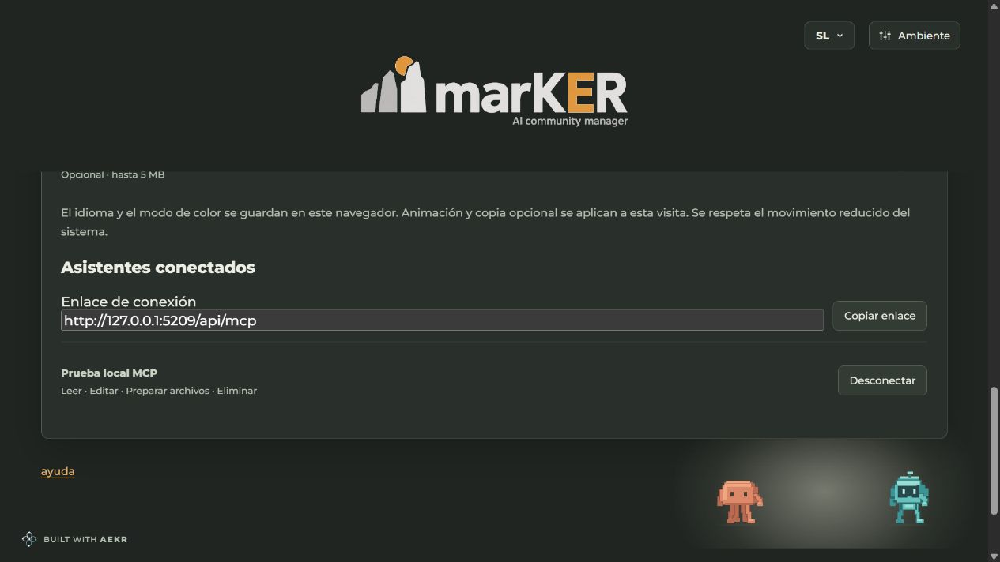

# Historical synthetic local connector view

This original screenshot was explicitly approved for this review package by the
implementation coordinator. It shows the isolated local fixture, a test client
and a loopback connection URL. No credential or owner runtime data is visible.
It is a retained illustration from the original connector publication, not the current seamless connection UI, product source or a fresh hosted readback. Current connection/context Help images live in the projected public/help source.

The coordinator reports English/light and Spanish/dark connection-list checks,
two-step revocation and Spanish consent font/logo/overflow checks passing. This
image illustrates one local state; it does not establish actual Dot installation,
all keyboard/device paths, human UAT or hosted activation. Its exact PNG hash is
included in the package manifest. The optional consent screenshot is omitted
because its captured pixels did not reliably include the logo.
