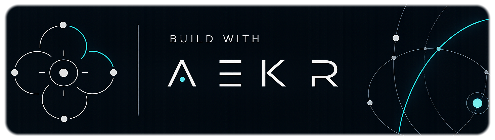

# marKER

See the [current verified state and prioritized review backlog](docs/current-status-2026-10-24.md)
for the latest delivery evidence and remaining work.

The prepared [central Analytics integration](docs/analytics-integration.md)
adds owner-scoped preferences and authorized audience counts while campaigns
remain native. [Commercial research](docs/analytics-commercial-research-20261025.md)
separates a proposed sponsorship/lead offer from actual agreements and revenue.

External assistants can use the additive [authenticated MCP connector](docs/mcp-connector.md)
to read products/materials and prepare editable campaigns with marKER's native
algorithms. Owner review and approval stay in marKER. Deployment/host installation
and social publishing are separate from source implementation. The normal
connection uses the registered assistant app and OAuth, with login resumed
automatically. Local bridge scripts are development-only tooling.

Private editorial console with products, shared social accounts, text/Markdown Spaces, campaigns, per-destination drafts, manual review/export and explicitly confirmed outcomes. The approved identity and decorative Claude/Codex pixel characters are preserved.

marKER's foundation is its own rules engine: organize material in Space, assemble an editable campaign, review and export it without connecting an AI agent. The product serves a solo marketer who wants time back, with a simple workflow for a Gen Z audience. Agents are optional collaborators that improve material and drafts through the same Studio rules; they must preserve the native workflow. The additive MCP connector supports external assistants; production activation and real host verification remain separate. Social publishing stays deferred.

Hosted review: [marker.aekr.io](https://marker.aekr.io). Access uses browser-bound eight-digit email codes for the configured sole owner, server-side opaque sessions and a dedicated Cloudflare D1 database. Supabase remains an inactive prepared adapter. The hosted text workspace has an initial 1 MiB ceiling.

Authentication now has one persisted operator and `tenant_id`. Optional direct Google sign-in binds the verified provider identity through a recent email sign-in; email remains available for recovery. There is no signup, team or tenant selector. See [configuration and linking](docs/authentication.md); provider activation and the additive hosted migration are separate from installing this code.

Run `npm install` and `npm run dev` for local engineering work. Data starts empty and is saved to ignored `.local/workspace.json`; it survives reload and server restart. Use one development process per path. Local mode trusts this Windows account and does not emulate hosted email authentication. Installing/building does not deploy or send mail.

`npm test` checks domain transitions, revision conflicts, real SQLite auth/data transactions with synthetic mail, inactive Supabase mocks, animation and optional cache. `npm run build` checks frontend/server types, builds the UI and verifies the immutable logo. `npm run types:worker` regenerates Worker types. **Environment / Ambiente** contains language and decoration switches, scene playback and pause. The lower-left signature reuses accreatio's original AEKR mark.

The interface defaults to English; the Environment switch selects English when on and Spanish when off, remembering the choice on this browser. UI text uses the supplied self-hosted Montserrat Medium, with ExtraBold headings and selected module buttons. The approved logo remains its original image. Font copyright and the supplied SIL OFL are included under `public/fonts/`.

Environment also offers an optional dark mode, shared with Settings and remembered in this browser. Its charcoal palette includes the banner, forms, Studio, Agents and help. The dark logo presentation derives its geometry from the complete original image, removes the light paper field and adapts neutral ink for contrast while preserving the orange; light mode continues using the original PNG.

Each authenticated module has one lowercase `help` link at its bottom left, within the section. Its visual guide has a topic index, numbered steps and an expandable screenshot for every step, in English and Spanish. Profile opens its own guide; the Agents panel also has contextual help. Environment's authenticated **help section** opens the complete topic index. Screenshots use synthetic sample data and the actual interface. Login instructions are separate: after a failed sign-in, **Get help** asks for an email and sends access instructions on explicit submission, subject to the existing authorized-recipient and request limits.

The initials button beside Environment opens Profile, Settings and Reload; Sign out is visible beside it. Optional local decorative assets are available only after signing in, remain off by default and are removed on sign-out. Codes, access instructions and transactional notices use `marker@aekr.io` as sender and reply-to. The same alias handles product contact, privacy, security and help; this does not add it as a login identity. See [email operations](docs/email.md).

See [console behavior and setup](docs/console.md), [architecture](docs/architecture.md), [private hosted Studio](docs/hosted-studio.md), [Agents](docs/agents.md) and [decoration](docs/decoration.md). Space/Campaign includes media capture, classification, agent-assisted copy, deterministic template assembly and reviewed MP4/TXT export. The local Agents panel uses an explicitly paired Codex ChatGPT bridge; [setup and account checks](docs/AGENT_BRIDGE.md) describe the local runtime. The [MCP connector](docs/mcp-connector.md) adds delegated product tools. Hosted subscription inference, connected social publication, native Android automation, paid activation and live metrics remain pending. Paid proposals stay paused. Export never marks a post published or deletes its source.

The owner-requested three fictional DEMO scenarios and the ordered implementation backlog are described in [implementation next steps](docs/implementation-next-steps.md). Examples remain editable drafts; the simulated paid proposal stays paused.

The [assistant integration design](docs/assistant-integration-design-2026-10-24.md) defines the normal external-assistant OAuth connection and real-client checks. The [connection decision](docs/ai-connection-decision.md) separately records hosted-app Sign in with ChatGPT inference requirements. The developer-only local Codex bridge uses its official managed ChatGPT login and refuses hosted origins and API-key billing; it is not part of normal connection.

The owner submitted the SIWC interest request; receipt is acknowledged, while admission and plan-usage permission remain pending. A [local text simulation](docs/text-simulation.md) is available in the development Editorial queue to select sources, review a simulated response and save an editable draft. It makes no OpenAI requests and is excluded from the production UI.

---

Built with the **AI Engineering Knowledge Repo (AEKR)** workflow.

# Space / Campaign studio

The console includes a raw-media library, manual classification, editable account-free campaign recipes, actual FFmpeg previews and approved MP4/TXT exports. The hosted adapter uses private R2, separate D1 entities and a bounded managed-container processor behind the existing owner login. See [hosted setup, limits and recovery](docs/hosted-studio.md). [Local engineering setup](docs/local-studio.md) includes the optional [local agent bridge](docs/AGENT_BRIDGE.md); no social provider is enabled.
