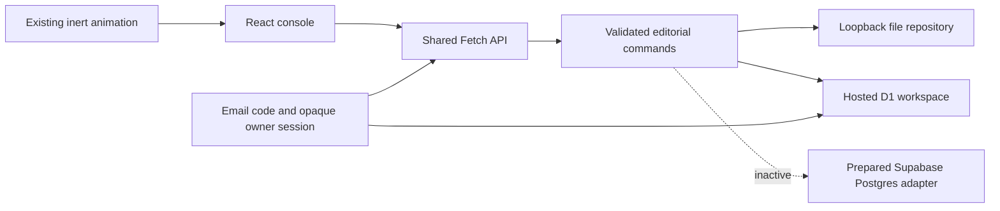

# Editorial architecture

Space and Campaigns have a native deterministic foundation. Classification, source eligibility, assembly, revision checks, rendering, approval and manual export must remain usable with no agent connection. Agents can contribute or refine material and recipes through these same boundaries; their availability must never become a prerequisite for the native flow. This preserves the product goal of reducing a solo marketer's active preparation time. Gen Z usability is a design goal, not a measured demographic claim.

The additive [MCP connector](mcp-connector.md) exposes external-assistant tools over the native engine, preserving editable drafts and manual export. Its source implementation is separate from hosted deployment and actual assistant installation. Social-account publication remains deferred.

`src/core/domain.ts` owns relationships, review/result transitions, account-level absolute-slot conflicts and deletion guards. The server accepts one explicit command plus the current workspace revision, validates it and persists atomically. The browser cannot overwrite a whole document or invent a revision; a concurrent revision produces HTTP 409. No external effect is performed by a domain command. New IDs come from platform cryptography.

`server/api.ts` supplies the same bounded JSON command contract to the Vite development middleware and `server/worker.ts`. Local storage uses a serialized queue and atomic file replacement; operate one process per data path. The prepared Postgres adapter uses Supabase REST and one owner-restricted JSONB workspace with an atomic compare-and-swap RPC. This is a bounded first slice: normalization is required when independent entity queries/jobs/media or size/concurrency needs justify it. The API has no multi-tenant scope or untrusted object-key path construction.

The domain-test release uses native email-code authentication adapted from owned aekr-web analytics, with separate product tables/cookies/secret. `server/native-auth.js` and its store enforce single-use browser-bound codes, an email allowlist, durable rate limits, session expiry/revocation and Origin checks. `server/d1.ts` uses one atomic revision-checked insert/update, with a 1 MiB hosted ceiling. `migrations-d1/0001_private.sql` is applied to the dedicated marker-private database. Supabase/Postgres remain inactive preparation. Auth expiry is checked per request; scheduled/request-time cleanup removes expired rows. Real mailbox/owner UAT remains distinct from SQLite/fake-mail tests and live anonymous/negative checks.

Static assets contain no private data. The Vite middleware is development-only and is not bundled into the Worker. Build inputs are explicitly `dist/` plus the Worker dependency graph; governance, local state and source receipts are outside those inputs. No analytics database, key, session or unrelated service is reused by the domain deployment.

Current source also includes private R2/processor jobs and admission limits, native email/Google/GitHub authentication, account-wide deletion, the local Codex bridge and the additive MCP connector. Their specialized documents and tests supplement the original editorial diagram above. Hosted subscription inference and authorized social adapters remain separate future work. Generated text, copied files and attempted remote operations never establish a confirmed external result.

The connector uses scoped opaque OAuth credentials and stateless MCP HTTP. Its finite tools call existing editorial/Studio handlers; they do not replace domain validation or the classifier/planner. Durable request receipts guard duplicate effects, while revision/fingerprint checks remain in the backend. Human approval remains a separate first-party action. Migration 0010 adds delegated credentials/history and account-deletion freeze; production installation and a real dot conversation require subsequent verification.

Primary references consulted on 2026-10-23: [Workers best practices](https://developers.cloudflare.com/workers/best-practices/workers-best-practices/), [static asset routing](https://developers.cloudflare.com/workers/static-assets/routing/worker-script/), [Supabase RLS](https://supabase.com/docs/guides/database/postgres/row-level-security), [Auth user verification](https://supabase.com/docs/reference/javascript/auth-getuser), and [PostgreSQL RPC](https://supabase.com/docs/reference/javascript/rpc). Documentation confirms interfaces, not access to an actual configured environment.
