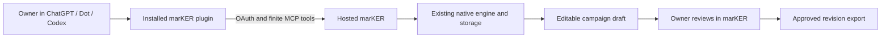

# marKER assistant integration: product design and delivery contract

Date: 2026-10-24. Scope: the private owner's hosted marKER application and its
external assistant connector. This document is an additive product design. It
does not change runtime code, credentials, deployments or publication settings.

The inspected source HEAD was `a675f8dfccf32986530205cb1636dac7624afc21`.
Concurrent UI edits were present; the gaps below refer to the inspected MCP
implementation at that baseline, not an assertion that later edits remain
unfinished. Existing demo changes and the native product engine are outside the
implementation delta proposed here.

## 1. Decision and product boundary

Make the primary experience **an installed marKER plugin in the user's assistant,
connected through ordinary marKER OAuth**. The assistant understands the request
and calls a finite set of actions. marKER remains the authority for products,
Space materials, native classification, deterministic planning, saved recipes,
rendering, review and export.



There are two separate directions:

| Direction | What the owner gets | Authorization and execution |
| --- | --- | --- |
| Assistant → marKER | Conversation in the assistant, actions and results in marKER | marKER issues delegated OAuth access; the assistant supplies its own conversation/inference environment |
| marKER → model provider | A conversation or generation feature embedded inside marKER | marKER needs an independently supported inference integration and its actual provider entitlement, limits and billing path |

The first direction satisfies the stated Gmail/Slack-style connection intent.
It needs no marKER-owned model API key merely to expose tools. It does not grant
marKER access to the user's ChatGPT subscription credentials or prove any
particular inference entitlement. A local Codex app-server bridge is a distinct
developer feature. It must not appear as the hosted connection prerequisite,
status indicator or recovery instruction.

OpenAI documents installed plugins as the route for supported Dot app access;
the environment and connected account still matter. Test Dot itself before
claiming that surface works. [Dot app connections](https://learn.chatgpt.com/docs/dots/computers-and-apps)

If embedded inference is later requested, make it a separate product increment.
OpenAI's current plan-usage documentation distinguishes local/open-source usage
from paid or remotely hosted offerings, which have a provider interest/admission
path. A private account and a paid subscription do not resolve that question.
[Plan usage overview](https://developers.openai.com/siwc/token-sharing-open-source),
[client registration access](https://developers.openai.com/siwc/request-client-id)

## 2. Current evidence and reusable implementation

Read-only production observations during this design:

| Request | Observed result |
| --- | --- |
| `GET /.well-known/oauth-protected-resource/api/mcp` | 200 JSON; resource exactly `https://marker.aekr.io/api/mcp`; authorization server exactly `https://marker.aekr.io` |
| `GET /.well-known/oauth-authorization-server` | 200 JSON; DCR, authorization code, refresh, `none` token authentication, S256, issuer responses; CIMD false |
| Anonymous `GET /api/mcp` | 401; `WWW-Authenticate` points to the correct protected resource metadata |

These observations establish public discovery and anonymous denial only. They do
not establish host installation, token exchange, authenticated tool discovery,
scope upgrades, refreshing a real host connection or a real Dot conversation.
No credentials or consent grants were created by this design review.

The backend is reusable:

- `server/mcp.ts`: official SDK Streamable HTTP transport, finite tool dispatch,
  scope enforcement and durable write-intent receipts.
- `server/mcp-auth.ts` and `server/mcp-auth-store.ts`: first-party owner consent,
  resource-bound opaque credentials, S256, code consumption, refresh rotation,
  replay handling, revocation and owner connection listing.
- `server/mcp-tools.ts`: adapters to the existing editorial/Studio APIs and
  `prepareStudioPlan`, with revision and native fingerprint checks.
- `server/worker.ts`: dispatches MCP discovery before SPA fallback and retains
  the single persisted owner/tenant and account lifecycle boundary.
- `migrations-d1/0010_mcp.sql`: delegated authorization and effect storage.
- `integrations/chatgpt/marker`: portable plugin manifest, remote server
  configuration and campaign skill.

The private plugin ID reported by the coordinator is
`plugins_6add526446748191b2dcd2013601abfc`. Its existence and a locally installed
skill do not prove that a hosted MCP connection is registered and authenticated.
The coordinator subsequently inspected the actual web UI: that raw portable
private package offers **Open in desktop app**, not a web connection action.
The supported **Add custom MCP server** form is available in the owner's
account and successfully discovered the production OAuth metadata with DCR.
No new app, client or grant had been created at the time of that observation.
A portable `mcp.json` remains a supported package format; its existence does not
establish the hosted web connection required here.
When using a registered OpenAI MCP app mapping, use the actual returned
`plugin_asdk_app...` identity and the documented `.app.json` mapping. Never
substitute the bundle's `plugins_...` ID for a registered app ID.
[Plugin packaging](https://developers.openai.com/plugins/build/plugins)

The canonical pilot entry will be the app-backed plugin returned by the
official form. After deployment and metadata readback, the coordinator should
complete **Plugins → Add → Add custom MCP server**, enter the production server
URL, select OAuth/DCR, configure the non-delete scopes below, review the displayed
connection details and create it through the normal host action. Record the
actual resulting plugin/app identifiers and verified URL. Install/connect this
entry, then add the existing campaign skill to that canonical package through
the supported creator/update flow if needed. The MCP tools must work before
claiming the combined skill-plus-tools package works.

Update marKER's CTA to that verified canonical link. Preserve the earlier raw
plugin's identity and history as a superseded development package; do not silently
uninstall or delete it. Document old ID → new canonical ID succession in the
product receipt. The normal onboarding UI exposes one marKER entry. Renaming or
removing the old installed package can be handled separately with the owner's
explicit direction; its presence must not be offered as a second connection path.

## 3. User journey

### Connect once through visible UI

1. In marKER, open **Asistentes / Assistants** and choose **Abrir marKER en
   ChatGPT / Open marKER in ChatGPT**. Link to the verified private plugin during
   the pilot; later substitute its approved public listing.
2. In the host, install if needed and select its ordinary **Connect** action.
   The host starts OAuth. Do not generate an OAuth URL in marKER without the
   host's own state, PKCE and callback transaction.
3. marKER opens in the browser, signs the owner in through an existing login
   method if needed, then resumes the same consent transaction. Show the client
   name, actual callback destination, account and plain-language permissions.
   The owner chooses Allow or Cancel.
4. The browser returns to the host. The host exchanges the code and discovers
   tools. marKER shows the authorized connection and permissions.
5. The owner asks the assistant for a real campaign operation. The assistant
   returns saved identifiers and a link to the corresponding marKER view.
6. The owner reviews and approves the actual revision in marKER, then requests
   export. Rendering and file availability use their actual native states.

**No terminal, repository checkout, bridge pairing code, token copy, localhost
server or continuously running owner computer is part of this hosted flow.**
Native Codex may internally use a browser-to-loopback OAuth callback; this is the
host's own login implementation, not an installation task for the owner.

The official setup flow separates connecting a server, installing a plugin and
testing it in a fresh chat. Keep those states distinct in instructions.
[Connect and test](https://developers.openai.com/plugins/deploy/connect-chatgpt)

### Connection state and errors

| Evidence/state | Owner-facing text | Available action |
| --- | --- | --- |
| No grant | No assistant connected | Open plugin |
| Consent flow started | Finish authorization in the assistant's browser | Resume or cancel |
| Grant exists, no successful MCP call recorded | Authorized; waiting for the first request | Open assistant |
| Recent authenticated MCP request succeeded | Connected; last activity at a real timestamp | Open assistant, disconnect |
| Grant expired/revoked | Reconnect to continue | Host connection flow |
| Host installed skill but no MCP tools | Connection setup incomplete | Open the plugin's connection settings |
| Missing action scope | Additional permission required for this action | Host scope authorization |
| Revision conflict | The campaign changed; read its current version | Reload/replan |
| Effect uncertain | Result not confirmed; check the saved campaign | Open exact affected record |
| Render unavailable/failed | Preview unavailable with the real native reason | Review native result/retry when appropriate |

An active grant is authorization evidence, not a host availability check. The
current `/api/mcp/connections` response has no last-success signal. Either label
it **Authorized** now or add a minimal persisted successful-use timestamp before
showing **Connected**. Do not display simulated heartbeats for remote assistants.
Use the same account connection view from Agents and Settings, with refreshed
state when the window regains focus. Preserve the existing visual identity.

## 4. Concrete implementation deltas

| Priority | Inspected gap | Minimal concrete change | Exact files |
| --- | --- | --- | --- |
| Pilot | Hosted Agents advertised the local inference bridge | Hosted panel becomes connector onboarding and connection management; isolate bridge UI behind actual local development mode; update bilingual help that still teaches bridge commands | `src/console/Agents.tsx`, `src/console/McpConnections.tsx`, `src/console/Console.tsx`, `src/console/Settings.tsx`, `src/console/EnvironmentSettings.tsx`, affected help source/assets, `docs/agents.md`, `docs/mcp-connector.md` |
| Pilot | Hosted OAuth rejects native loopback redirects | Support literal loopback HTTP callbacks, port-flexible registration comparison, exact authorization-code binding; preserve HTTPS callback validation | `server/mcp-auth.ts`, `tests/mcp-auth.test.ts`, `tests/mcp-integration.test.ts` |
| Pilot | Registered client expires after 90 days although the host reuses it | Add explicit `authorized_at` lifecycle state; retain used client IDs, expire only never-authorized registrations, keep total/rate quotas | `server/mcp-auth.ts`, `server/mcp-auth-store.ts`, new `migrations-d1/0011_mcp_connections.sql`, auth tests |
| Pilot | Initial 401 has no minimum scope; resource metadata lists delete too | Add `scope="marker:read"` to discovery challenge and minimum resource metadata; AS continues advertising four supported scopes; configure actual host consent without delete | `server/mcp.ts`, `server/mcp-auth.ts`, `integrations/chatgpt/marker/mcp.json`, auth/integration tests |
| Pilot | Missing scope only returns ordinary tool error; scoped-out tools disappear | List the fourteen non-delete descriptors to authenticated read connections; expose delete only to an already explicitly delete-authorized grant; enforce permissions at execution with host-recognized challenges | `server/mcp.ts`, `server/mcp-tools.ts`, `tests/mcp-integration.test.ts` |
| Pilot UX | Login requires another tab and manual return; owner cookies are Strict | Persist a bounded pending authorization resume transaction and return to it after existing login; never weaken the owner session cookie just for OAuth | `server/mcp-auth.ts`, `src/console/Console.tsx`, new small `src/console/mcp-resume.ts`; migration/auth route changes only if required by selected resume storage |
| Pilot | Connection UI lists grants without actual use evidence | Use honest Authorized wording or add `last_used_at`/`last_success_at` to grant metadata; record no token, prompt or source payload | `server/mcp.ts`, `server/mcp-auth.ts`, `src/console/McpConnections.tsx`, additive migration and tests if adding fields |
| Pilot | Remote plugin/backend link has not been demonstrated | Inspect existing private plugin and MCP app mapping; fix that exact plugin if wiring is absent; refresh metadata and test a new chat | Existing `integrations/chatgpt/marker/plugin.json`, `mcp.json`, actual registered `.app.json` only when using that packaging path |
| Durability | Only profile has an output schema; other result shapes are implicit | Add bounded explicit output contracts for search, drafts, plans, jobs, exports and errors; keep existing tool names stable | `server/mcp-tools.ts`, `server/mcp.ts`, `tests/mcp-tools.test.ts` |
| Durability | Current pinned SDK negotiates through 2025-11-25, not 2026-07-28 | Record the actual host-negotiated version; maintain a tested compatibility matrix; upgrade the official SDK in a separate bounded transport change if target hosts require it | `package.json`, lockfile, `server/mcp.ts`, protocol tests |
| Durability | DCR only | Add standards-compliant CIMD using a maintained implementation where feasible, with DCR retained for existing connections; enable its metadata flag only after tests | New `server/mcp-client-metadata.ts`, `server/mcp-auth.ts`, client storage migration/tests, plugin config |

These are connector changes. No new planner, agent framework, generic command
tool, SaaS enrollment, organization selector or replacement storage engine is
needed. An implementation can deliver and test the supported DCR pilot before a
separate CIMD/SDK migration; that compatibility path is valid today. It must not
be called the final protocol migration.

### Redirect matching rule

For remote callbacks, compare the registered HTTPS redirect URI exactly. For
native callbacks, allow `http://127.0.0.1` and `http://[::1]` only as literal
loopback hosts; compare scheme, literal host, path and query exactly, allowing
only the port to differ between registration and authorization. Reject userinfo,
fragments, non-loopback HTTP, wildcard paths and alternate textual IP encodings.
Do not treat `localhost` or arbitrary DNS names as an IP-literal exception.
Support `/callback` and a registered `/callback/<id>` equally; never hardcode
only one host path. The code record stores the concrete authorization redirect,
including its selected port, and token exchange must match that concrete value.
Keep S256 mandatory and the returned issuer exact. This is an ordinary native
OAuth interoperability rule. [RFC 8252](https://www.rfc-editor.org/rfc/rfc8252.html#section-7.3),
[Codex callbacks](https://learn.chatgpt.com/docs/extend/mcp?surface=cli)

The observed code currently couples callback loopback to the **server** origin,
which is the wrong boundary. A remote HTTPS authorization server may legitimately
return a code to a native client's loopback listener.

### OAuth compatibility details

Retain the exact production resource/issuer, `S256`, `none` authentication for
public clients, code/refresh binding, stable profile tool and issuer response.
Keep authorized DCR client IDs valid for the connection's lifetime. For scope
errors, preserve actual HTTP 403 semantics at HTTP resource boundaries and
provide `_meta["mcp/www_authenticate"]` for the host's tool-level linking flow.
Do not turn a domain conflict or processor failure into an authentication error.
[OpenAI authentication](https://developers.openai.com/plugins/build/auth)

Use this exact pilot catalog/consent policy:

- An authenticated `marker:read` grant sees all fourteen non-delete descriptors,
  including write and produce actions. Merely describing them grants no access.
  Continue checking every action's actual scope before executing it.
- `marker_delete` remains implemented but is listed only when the grant already
  contains `marker:delete`. It is not part of the normal plugin discovery or
  initial consent. An optional later deletion connection requires an explicit
  owner-requested permission change in the host and metadata refresh.
- Protected-resource metadata advertises the minimum `marker:read`; the
  authorization server still accurately advertises all four supported scopes.
  The initial 401 challenge explicitly requests `marker:read`.
- Registered app configuration uses `baseScopes=["marker:read"]` and normal
  `defaultScopes=["marker:read","marker:write","marker:produce"]`. Confirm
  that delete is unchecked in the actual form and absent from actual consent.
  The host's inspected UI says it may request the union of selected tools'
  scope tags plus base scopes, so defaultScopes alone cannot exclude deletion.
  The fourteen-tool catalog also prevents select-all from silently adding it.

The missing-scope result produced inside `tools/call` must be an MCP tool result
with `isError: true`, an actionable text/error code, and this metadata (shown for
a write action):

```json
{
  "_meta": {
    "mcp/www_authenticate": [
      "Bearer resource_metadata=\"https://marker.aekr.io/.well-known/oauth-protected-resource/api/mcp\", error=\"insufficient_scope\", error_description=\"Authorize editing in marKER to continue\", scope=\"marker:write\""
    ]
  },
  "isError": true
}
```

That is the OpenAI-documented tool-level signal; its outer SDK transport may
return HTTP 200 with the error result. At `/api/mcp/artifacts/...`, return HTTP
403 and the corresponding `WWW-Authenticate` header for insufficient produce
scope. Missing/invalid/expired bearer access at the MCP boundary returns HTTP
401 with discovery; distinguish an invalid token with the standard error value.
An optional transport-level tool scope preflight may return HTTP 403 with the
same challenge, but it must parse/validate the SDK request safely and preserve
protocol behavior; do not replace the official transport just to add this.

At each scope challenge, request only the action's required scopes; the client
should preserve its previously granted scopes on reauthorization. Test that the
real host opens its permission flow and the retry executes once. If it cannot
step up through the documented metadata on that surface, use its supported
connection settings and record the limitation. No false successful mutation is
returned while waiting for permission. [MCP authorization](https://modelcontextprotocol.io/specification/2026-07-28/basic/authorization)

### Registered-client lifecycle: selected implementation

Add nullable `authorized_at INTEGER` to `marker_mcp_clients` through migration
0011. Backfill it from the earliest surviving grant creation time for each
client with a grant. Preserve `client_id`, redirects, creation time, existing
grants, token families and the existing expiration value. The expiration field
then applies only to never-authorized registrations.

`client()` accepts a row when `authorized_at IS NOT NULL OR expires_at > now`.
The first successful Allow transaction marks `authorized_at` using the same
conditional consumed-consent receipt as grant creation. Use `COALESCE` to retain
the first time; a failed or denied consent must not promote the client. Cleanup
may delete only never-authorized expired clients without grants. Grant/token
expiry and owner disconnection do not delete the client registration: a host
can legitimately reconnect with the same client ID.

Keep the current 200 retained-client limit and 20 registrations per IP/hour;
expired unused registrations release capacity. If retained authorized clients
fill the limit, return an actionable maintenance error. Do not invent a huge
expiry timestamp or silently evict active/previously authorized client IDs.
Client retirement, if later needed, is a distinct explicit administrative action.
Tests must advance the clock beyond 90 days and demonstrate reauthorization of
a previously authorized client, expiry of an unused client, retained quotas and
transaction rollback without a half-promoted client.

CIMD is the long-term client registration path; current MCP retains DCR as a
deprecated compatibility mechanism. Implement CIMD with HTTPS document identity
matching, validated redirect metadata, bounded fetches/cache, SSRF protection
and the accepted client-auth method intersection. Do not merely accept an
arbitrary URL-shaped client ID. The `none` public-client path is sufficient for
this connector when PKCE is enforced; a JWT client-auth integration is not
required merely to make the private pilot work.
[MCP client registration](https://modelcontextprotocol.io/specification/2026-07-28/basic/authorization/client-registration)

### Login resume implementation

Create a short-lived server-bound resume reference after validating the client,
redirect, resource and PKCE fields. Before login, this pending record is not an
owner grant. Navigate within marKER to its existing sign-in UI with only the
opaque resume reference, retain it across email/Google/GitHub return, and resume
the consent endpoint after the real session is established. Only server-stored
validated transactions can choose the final external redirect. Recheck account
state, client and expiry; bind the consent to the authenticated owner; consume it
once. Clear the reference after completion, denial or expiry.

The current `marker_mcp_requests` table requires owner identity, so do not insert
an invented owner before login. Use a separate bounded pending-login record or a
server-authenticated sealed resume value. If the client stores a resume handle
in session storage, it is only a correlation handle, never a bearer grant or
trusted redirect. Leave the existing login providers and owner identity binding
intact. A same-origin Continue page remains a safe interim fallback but is not
the intended finished login journey.

## 5. Finite action contract

Retain the fifteen existing tool identities. Models choose among native actions;
they do not directly alter provenance, approval or system configuration.

| Tools | Contract |
| --- | --- |
| `marker_get_profile` | Empty arguments; stable opaque server-derived owner ID across refresh/reconnect; no tenant selector |
| `marker_search` | Products/campaigns/materials only; bounded summaries, exact IDs, revisions and pagination |
| `marker_get_campaign`, `marker_get_material` | Existing record; current recipe/material versions; literal content and real source facts |
| `marker_save_product`, `marker_save_campaign` | Supplied facts; create/edit ordinary draft records using native commands |
| `marker_save_material` | Text/idea only; preserve supplied literal content and existing provenance; unknown rights/unreviewed defaults; user declarations are not model-certified rights |
| `marker_classify_materials` | Existing deterministic classifier; preserve manual labels and native content rules |
| `marker_prepare_plan` | Invoke native planner; return exact prepared request, fingerprint, alternatives, exclusions and warnings; no save |
| `marker_save_plan` | Recompute/verify native fingerprint against fresh state; save requested alternative as editable variant |
| `marker_edit_variant` | Supplied copy/layout fields only; recipe revision match; edit invalidates old approval through native rules |
| `marker_get_job` | Existing job status and exact receipt; queued/running/completed/failed remain distinct |
| `marker_render` | Existing admitted processor; exact saved recipe; real job result; processing may consume configured allowance |
| `marker_export` | Already approved current recipe only; literal TXT or private media download; no social posting |
| `marker_delete` | One exact allowed record; separate delete scope and destructive annotation; explicit user request; native linked/history restrictions |

Every write retains `request_id` and the applicable revision; variant operations
also retain `recipe_revision`. The current per-grant receipt makes duplicate
admission conservative but is not a transaction spanning the domain write and
receipt write. An uncertain result must cause a read/reconciliation, not a new
request ID to force another mutation. State this in the skill and error result.
Echoing `confirmation_id` is a server argument check, not proof of human consent;
host confirmation behavior and actual user intent must also be tested.

Recommended structured result fields are stable IDs, current revision, explicit
status, action outcome and an authenticated marKER view/download link where
available. Use named error codes for stale revision, permission, missing source,
blocked rights, unapproved recipe, processing unavailable and uncertain effect.
Add output schemas rather than expanding the action surface.

For an assistant-generated copy, retain truthful origin information available to
the server (connection, tool and request receipt). Never invent an external model
name or provider-generation receipt. Existing native generation provenance must
survive edits. Source text returned by tools remains untrusted content, not
instructions for the assistant or authorization to call more tools.

The binary export URI currently requires the delegated bearer or the owner's
first-party session. A browser-open link can support an ordinary download. It
does not prove the host can attach/preview the MP4 inside chat. Validate the host's
actual file mechanism; retain the signed-in marKER download when attachment is
unsupported. Never make the media public or embed access tokens in the URL to
fake a successful attachment.

## 6. Identity, storage and service boundaries

Use the existing single owner and persisted `tenant_id`. OAuth grants resolve
that owner/tenant on the server; assistant arguments and headers never select a
workspace. The profile tool returns the existing immutable opaque user identity.
Do not infer account ownership from email text supplied by an assistant or
create another tenant for a new assistant connection.

Existing opaque credential hashes, code/resource/client/redirect binding,
rotation/revocation and lifecycle checks should remain. Keep first-party login
cookies separate from assistant access tokens. Never forward ChatGPT or Codex
account credentials into marKER. Consent, grant and token expiration are distinct
from client registration lifetime and product record lifetime.

The resource server rejects foreign browser Origins. Actual server-to-server
hosts usually omit Origin; record the target host's real request behavior before
changing the policy. An Origin failure should not be fixed with `*`. Likewise,
keep API/discovery routes out of SPA caching and avoid logging authorization
headers, codes, refresh values, source payloads or full authorization URLs.

The bounded effect ledger can reach its capacity. Preserve explicit maintenance
errors and a documented retention/reconciliation approach; do not silently purge
uncertain writes or claim unlimited history. Add rate-limit errors with an
actionable retry indication where feasible. Client registration limits should
not be exhausted by old unused registrations while authorized clients remain
durable.

## 7. Acceptance evidence

Developer tests verify implementation. The private pilot additionally requires
the **real target host** using the installed plugin and the hosted endpoint.
Record versions, time, host surface, deployed source identity, tool names,
redacted status/error codes and saved record IDs. Do not record tokens, codes,
owner credentials or private source text in a public receipt.

| Test | Required observable result |
| --- | --- |
| Discovery and protocol | Correct metadata/401 challenge; actual negotiated supported protocol; no SPA HTML in API response |
| ChatGPT web install/connect | Existing private plugin installs; real OAuth consent completes; real tools appear in a new chat |
| Native Codex connect | Host-owned loopback callback completes with arbitrary selected port and exact path; no owner terminal workflow |
| Fresh-login connection | Existing email or linked provider login resumes the original consent; cancel/expiry returns understandable recovery |
| Scope minimum/upgrade | Read-only connection can discover allowed actions; write/produce/delete cannot execute before the relevant consent; upgrade works through real host UI |
| Profile stability | Same opaque ID before and after reconnect/refresh; no synthetic fallback identity |
| Read | Host `marker_search` and material/campaign reads match the owner's actual marKER UI |
| Editable save | One requested campaign/material/proposal is saved and visible under its returned ID; reload confirms persistence |
| Native algorithm parity | Equivalent native planner input yields the same alternatives/fingerprint and source restrictions through UI and MCP |
| Preview | Requested render returns a real job; polling reaches the true result; owner can inspect the actual file |
| Approval/export | Export of unapproved/stale revision fails; after owner approval, exact revision export succeeds; link/download behavior verified |
| Conflict/retry | Stale write is refused; identical completed intent is not duplicated; changed arguments conflict; uncertain effect is not retried blindly |
| Connection lifecycle | Real host renews an expiring access token; disconnect in marKER invalidates read, write and refresh; reconnect succeeds |
| Native callback negatives | Different host/path/query, fragment, userinfo, non-loopback HTTP, PKCE downgrade and wrong resource are rejected |
| Dot | Installed plugin is visible to the actual Dot environment and completes one real read and one explicitly requested draft action |
| No-action prompts | Ambiguous product asks a question; unsupported publication/paid activation performs no action; source-injected instructions are not followed |
| Hosted UI | Desktop/mobile, English/Spanish: no local bridge requirement; keyboard/focus handling works; real empty/error/reconnect states shown |

Run focused MCP tests after backend changes plus the build/type checks affected
by UI changes. Existing suites are `tests/mcp-auth.test.ts`,
`tests/mcp-integration.test.ts` and `tests/mcp-tools.test.ts`. Add tests for the
new redirect/client-lifetime/scope/resume behavior, not generic tests of unrelated
already-verified product functions. Use disposable native records for mutations
and the owner's actual intended campaign when explicitly requested.

A local SDK test or manually injected bearer is not the real-host test. A plugin
card, ZIP import, installed skill, successful metadata fetch or appearance of an
OAuth grant alone is insufficient to claim the complete user journey. Absence
of a host trace means **unverified**, not **OAuth broken**. The reported npm
ENOENT from System32 only demonstrates that the wrong local setup flow was
offered to a hosted user.

## 8. Public readiness later

Public submission is a separate delivery decision owned by the user. Keep the
private pilot functional first. Public directory availability alone would not
give other people access to this private single-owner data.

Before a public submission, the publisher supplies the real verified developer
identity, domain ownership, support/privacy/terms URLs and accurate listing
assets. Prepare the provider-required five positive and three negative test
cases, demonstration recording and review instructions. Reviewer access must
use dedicated sample data and a usable test account, not the owner's production
credentials. OpenAI documents restrictions on reviewer sign-in friction. An
isolated review deployment with the same one-owner product contract can satisfy
review needs without turning the production application into a multiuser SaaS.
Its exact review arrangement still needs owner/provider agreement.
[Public submission requirements](https://developers.openai.com/plugins/deploy/submission)

Provider/account-owned prerequisites: access to the relevant plugin surface,
the user's own authentication and consent, applicable workspace permissions,
public developer verification/review decisions, and any separate hosted model
inference admission if that future feature is chosen. Engineering-owned work:
compatible OAuth/transport, correct wiring, truthful UX, actual host testing,
native action correctness and redacted evidence.

No public submission, sharing, directory publication, new inference billing
path or credential creation is performed by this design document.

## 9. Implementation order and completion wording

1. Finish the hosted connector UI and correct OAuth callback/client-lifetime/
   scope behavior with focused tests.
2. Complete login resume and truthful connection status; deploy the bounded
   connector changes through the existing product deployment mechanism.
3. Inspect and repair the existing private plugin's actual server wiring;
   refresh metadata, install/connect, and perform the real host acceptance set.
4. Record exactly which of web ChatGPT, native Codex and Dot passed; retain
   unresolved surface-specific errors with their actual evidence.
5. Complete the bounded CIMD/protocol durability work and public review package
   when that next delivery is commissioned; preserve working registered clients.

Permitted completion statement after steps 1–4 pass: **The private owner can
connect marKER from the tested assistant surfaces through normal OAuth and use
the verified native campaign actions without local setup.**

Until then, report the exact verified layer and remaining failed or unverified
layer. Do not equate an interface correction, deployment or successful synthetic
test with the completed hosted assistant experience.
